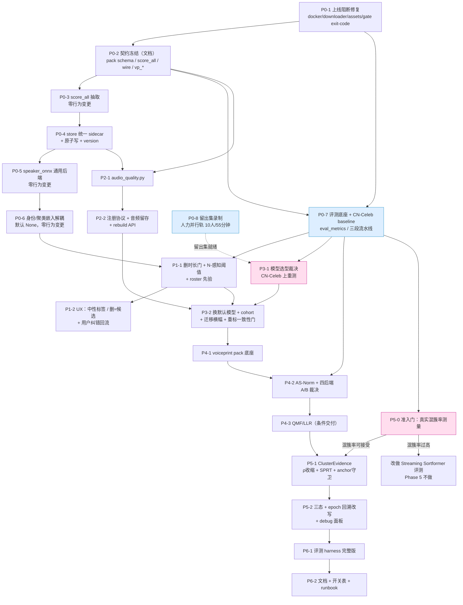

# 实时声纹识别升级开发计划

- 日期：2026-08-06
- 基线：`main` @ `a8cf3ea`，工作区干净
- 输入：8 份设计（T1–T8）+ 3 份对抗审查
- 调研依据：[docs/research/2026-08-06-realtime-voiceprint-survey.md](../../research/2026-08-06-realtime-voiceprint-survey.md)
- 单测基线（本人复核）：`168 tests collected`，`167 passed, 1 skipped`

---

## 1. 背景与目标

调研（survey §1）给出的物理极限是：说话人识别的 EER 随时长每减半翻 2~2.4 倍；中文比英语难一个数量级（CN-Celeb 6% vs VoxCeleb 0.6%）；同性别冒充者再乘 2.4。也就是说"一句 1 秒的中文短句、同性别、开集"是这个问题里最难的一格，任何工程手段都不可能把它做到"每句都认得出"。但我们离物理极限还很远：**在同一份 278 探针集上，现役配置（`pyannote/wespeaker-voxceleb-resnet34-LM` + cohort 中心化 + 阈值 0.82 + 2.0 秒时长门）只有 14.0% 的 turn 拿到名字**（本人实测，见 §11.A），而同一模型同一阈值仅仅去掉时长门就是 47.5%、换成 `3dspeaker/eres2netv2-zh-cn` 后在零误报阈值下是 85.6%。差距的三分之二来自两个与"模型不够强"无关的工程决策：一道过严的时长门，和一个 2024 年的英语训练模型。

本计划的目标不是"把短句认出来"（那是物理问题），而是：
1. 把已经拿得到的召回真正拿到手（删门、换模型、roster 先验）；
2. 让"认不出"和"认错"在 UI 上有本质区别（未注册者永不显示任何人名）；
3. 建立能证伪的评测底座，让后续每一次改动都有可比的数字；
4. 每一步都可灰度、可回滚、用户已注册的声纹不丢。

---

## 2. 成功判据

### 2.1 用户可见（最终验收，人工冒烟）

| # | 判据 |
|---|---|
| U1 | 按新协议注册满 20 秒净语音的人，连续说话 ≥2 秒时**稳定**显示名字，不再逐句忽有忽无 |
| U2 | 未注册者**在任何情况下**都不显示任何已注册者的姓名（不显示 `≈某某 0.79?` 这类提示），只显示中性标签「说话人 N」 |
| U3 | 音频不足是一等状态：显示「识别中…」+ 已累计秒数，而不是沉默 |
| U4 | 名字一旦确认，同一说话人的历史行被回溯改写；若后来被推翻，署名被撤销而不是留着错名 |
| U5 | 换嵌入模型后，用户看到明确的「需要重新录入 / 一键用已保存录音重建」提示，不是静默失效 |

### 2.2 数值指标（含不确定性标注）

| 指标 | 现状 | 目标 | 测量集 | 不确定性 |
|---|---|---|---|---|
| 被命名率 @FA=0 | **14.0%**（pyannote）/ **14.7%**（cnceleb） | Phase 1 ≥ 45% ；Phase 3 ≥ 80% | 278 探针集 | ⚠️ 只有 7 个说话人、~18 个同性别有序对。`min_resolvable_far` = 5.6%；FA=0/1668 按 rule of three 只能证明 FAR ≤ **0.18%**（95%），不能证明 0.01% |
| FAR @部署阈值，N=20 注册 | **6.7%**（2s）/ **12.3%**（4s） | ≤ 1%（2s） | CN-Celeb1 eval，conversational 子集 | ⚠️ 野生多体裁语料，对近场麦克风场景**偏悲观**；且 3D-Speaker 训练集可能与 CN-Celeb 有说话人重叠 → **排序可信，绝对值不可信** |
| DIR@FAR=1%，N=20，2s | **50.1%** | ≥ 62% | CN-Celeb1 eval | 同上 |
| session `wrong_name` | 0 | **0（硬红线，不可协商）** | `session_replay` 全部场景 + 留出集 | — |
| `identity_flips`（同一说话人段内名字变化次数） | 未测量 | Phase 5 相对 Phase 1 下降 ≥ 50% | `session_replay` | 需先建立基线 |
| 注册召回断崖 | 6 秒墙钟 ≈ **4.0 秒净语音**（p10），落在断崖区 | 20 秒净语音 | T6 实测 | 2s→3s 净语音之间 voxceleb `rec@0.82` 从 64.3% 跳到 92.9%（T6 实测，14 genuine trial，样本极小） |

### 2.3 全局门禁（每个 PR 都要过）

```bash
# G1 唯一验收命令
python -m pytest tests/diart_server -q \
  --ignore=tests/diart_server/test_e2e_websocket.py \
  --ignore=tests/diart_server/test_end_control.py \
  --ignore=tests/diart_server/test_failure_modes.py -p no:cacheprovider
```
判据：**`0 failed`** + **本 PR 新增的用例逐条点名且全部 pass** + **`git diff` 未删除任何既有测试**（白名单必须在 spec 里逐条列出「被哪条新测试取代、依据是什么」）。

> **裁决 D10**：8 份设计各写了一个绝对通过数（180/184/185/191/193 五个互斥值）。只要落地两个，其余全部误判为 FAIL。**绝对计数判据全部作废**，改用上面这条。

```bash
# G2 声纹回归门禁（任何触碰打分/身份链路的 PR）
DIART_MODELS_DIR=./models DIART_DEVICE=cuda DIART_VOICEPRINTS_DIR=./voiceprints \
  python scripts/verify_speaker_cross_matrix.py
```
判据：`FALSE_ACCEPTS=0` 且 `MISSED_GENUINE=0`，**退出码 0**。⚠️ 退出码 3（SKIPPED）自 P0-1 起视为 FAIL。

```bash
# G3 容器回归门禁（P0-1 起生效）
docker build -f docker/Dockerfile.cpu -t diart-gate . && \
  docker run --rm -d -p 7007:7007 --name diart-gate diart-gate && sleep 60 && \
  curl -s localhost:7007/v1/info | python -c "import json,sys; n=len(json.load(sys.stdin)['voiceprint_ready']); print('ready:',n); sys.exit(0 if n>=1 else 1)"
```
判据：退出码 0。**当前 HEAD 上这条必然失败**（build 直接报错；即使 build 成功 `ready` 也是 0）——这正是它作为回归门的价值。

```bash
# G4 数值门禁（P0-7 起生效）
python scripts/eval/gate.py --scorecard eval/out/scorecard.json \
  --baseline eval/baselines/<corpus>.<model>.<backend>.json
```
判据：`trials_hash` 一致；每个 stratum 的指标未劣于 baseline 的 speaker-block bootstrap 95% CI 上界 + 0.005。

---

## 3. 关键裁决

三份审查合计给出 5 个 blocker + 大量 major。以下是我的裁决，**理由写在每条后面**，不是两边说法的堆砌。

### D1 — 最高优先级的改动是「删掉 2.0 秒时长门」，不是换模型，更不是 QMF

**本人复算**（命令与完整输出见 §11.A）：

| 配置 | 被命名 | FA |
|---|---|---|
| cnceleb `thr=0.85` + `>=2.0s` 门（现状） | 41/278 = **14.7%** | 0/1668 |
| cnceleb `thr=0.85` **无门** | 156/278 = **56.1%** | **0/1668** |
| cnceleb `thr=0.8405`（impostor max+ε）无门 | 173/278 = 62.2% | 0/1668 |
| **T3 的 QMF/LLR @θ=5.70**（T3 自述） | 139/278 = **50.0%** | 0/1668 |
| pyannote `thr=0.82` + 门（现状默认） | 39/278 = **14.0%** | 0/1668 |
| pyannote `thr=0.82` **无门** | 132/278 = **47.5%** | **0/1668** |

结论：T3 声称的「14.7% → 50.0%，3.4×」**全部来自删门**，QMF 的边际贡献是 **−6pp**。T3 把「保留 2s 门 + 保留 0.85 阈值」两个变更捆在一起当对照，是归因错误。这与 T3 自己诚实给出的 C_llr 分解一致：判别损失占 73.5%，校准最多只能吃掉 26.5%。

**但必须同时记录这条结论的边界**（审查 2 与 T7 的实测都指向这里）：该 dump 的 impostor 只有 1668 条 / ~18 个同性别有序说话人对，`min_resolvable_far = 5.6%`。T7 在 CN-Celeb1 eval（196 人）上实测：**同一部署阈值 0.82，N=20 注册库、4 秒 turn 的实际 FAR 是 12.3%**。也就是说 —— **时长门从来不是保护我们的东西，是小探针集掩盖了问题**。

⇒ 删门是对的、收益是真的，但它必须：(a) 带 `DIART_VP_MIN_IDENTIFY_SECONDS` 开关；(b) 在 CN-Celeb baseline 上重新验证；(c) **与「阈值成为注册人数 N 的函数」同一个 PR 落地**。因此它排在 Phase 1 而不是 Phase 0（需要 P0-7 的 baseline 才能验收）。

### D2 — T3 从独立任务降级为「条件交付」；T2+T3 合并为一个 `scoring-backend` spec

理由：D1 已证明 QMF 在我们唯一的操作点（FA=0）上不如零成本对照。但 T3 有两样东西必须保留：**C_llr / C_llr_min 诊断能力**（唯一能回答「问题是判别还是校准」的工具）和 **`pipeline_fp` 打分链路指纹**（AS-Norm 一改刻度，旧系数必须被拒绝加载而不是静默生效）。

合并后的准入判据写死：**在同一张 `eval_metrics` 表上，`asnorm+qmf` 后端的 `named@FA=0` 必须严格高于 `flat-threshold-no-gate` 对照行，否则不上线。**

### D3 — T4+T5 合并为一个 `cluster-identity` spec，且放在最后，带准入门

T4 与 T5 是同一功能（簇级累积 + 回溯改写）的两份互不兼容实现。取舍：

| 组件 | 取谁 | 理由 |
|---|---|---|
| 累积数学 | **T5** | ρ=0.810 的实测组内相关 + design-effect 收缩 `Σllr/(1+(n−1)ρ)`。T4 的「LLR 直接求和 + cap」隐含 ρ=0，与实测直接矛盾 |
| 混簇守卫 | **T5** | anchor 纯度守卫（2-of-5 检测器）是 T4 完全没有的 |
| 线协议 | **T5** | `epoch` 键控是 O(1) 消息体，且消除了 identity 消息与 transcript 的到达顺序依赖；T4 的 `turn_ids` 数组随会话长度无界增长 |
| 三态语义 + 呈现规则 | **T4** | 状态词表、partial 降级规则、`renderLine` 内不许出现数字的静态守卫 |
| 未注册者 UX | **T4** | 见 D8 |
| debug 面板 + JSONL 回流 | **T4** | 唯一的域内标注回流管道 |

**准入门（硬性）**：Phase 5 开工前，必须先用 P0-7 的 `session_replay` 在 `data/2news.mp3` + 留出集上测出 diart 的**真实混簇率**。T5 自己的仿真显示混簇场景下 43% 的簇会被盖上一个名字、其中一半行是错的——如果真实混簇率高到让净收益为负，**Phase 5 直接改做 Streaming Sortformer 前端评测，而不是在一个坏前端上叠一层复杂守卫**。

**硬规则（不变量 1/3 的守护，写进单测）**：`identity_pcm is None`（多数重叠）或 `pure_seconds < min_candidate_seconds` 的 turn，**无论簇级状态如何，一律渲染中性标签，永不承载簇级署名**。T4 的「本轮没有证据 → 视为不矛盾 → 可改写」是错的：「没有证据」与「证据不矛盾」必须区分。这正是 `docs/bugs/2026-08-05-identity-continuity-overlap-purity` 修掉的行为换了个字段名。

### D4 — T1 拆两半：T1a 最先，T1b 在 T6 之后、T2 之前

- **T1a**（通用 `speaker_onnx` 后端 + 身份/聚类嵌入解耦，零行为变更）→ **Phase 0**。理由：它改变了所有 cohort / 阈值 / `store.vectors()` 查表的键。若后落地，Phase 3/4/5 的每一处查表都要返工；若先落地而下游不知情，会给「聚类模型」加载「身份模型」的标定——正是不变量 5 的违反形态。
- **T1b**（真正换模型）→ **Phase 3**，**必须排在 T6 注册协议之后**。理由（审查 1 finding #15，我认为是最有价值的非显然结论）：T1b 强制全员重录；若先于 T6，用户会用**已知不足的旧 6 秒协议**（实测只有 4.0 秒净语音，正落在 2s→3s 的召回断崖上）重录一次，T6 落地后又要再录一次。**代价：T1b 落地时必须重跑 T6 的一致性门标定（验收项 C3）并更新 `consistency_floor`** —— 这比让用户录两次便宜得多。

**同时修正 T1 的一个上线即禁用的缺陷**：T1 把 `settings.identity_embedding_model` 的默认值写成 `"3dspeaker/eres2netv2-zh-cn"`（非空），而解析顺序是 `params.identity_embedding_model or settings.identity_embedding_model or params.embedding_model`。⇒ 任何只传 `embedding_model` 的调用方（含 `verify_speaker_cross_matrix.py:282`）会在一个模型空间注册、另一个空间识别，`store.vectors()` 返回空 dict，识别永远返回 None 且无任何提示；而 cohort 要到 PR-3 才落地，期间 `voiceprint == disabled_no_cohort` 全局静默关闭。T1 自己的单测用 `monkeypatch` 把 settings 置空，恰好绕过了这个 bug。

⇒ **该默认值在 T1a 阶段必须是 `None`**，并补一条**不 monkeypatch settings** 的单测断言「shipped 默认值下 `session.identity_model == params.embedding_model`」。

### D5 — 模型选型不用 EER 决定，用「p99.5 阈值处召回 + CPU 延迟」在 CN-Celeb 上决定

**本人复算 + 2000 次配对 bootstrap**（§11.B）：

| 模型 | EER | zeroFA thr | rec@zeroFA | p99.5 thr | rec@p99.5 | CPU 1s / 12s(4线程) |
|---|---|---|---|---|---|---|
| `3dspeaker/eres2netv2-zh-cn` | **2.22%** | 0.810 | 85.6% | 0.789 | **95.0%** | 70.2 ms / 280.4 ms |
| `3dspeaker/campplus-zh-cn` | 3.60% | 0.788 | **89.6%** | 0.777 | 93.2% | **13.5 ms / 61.9 ms** |
| `pyannote/wespeaker-voxceleb-resnet34-LM`（现役默认） | 5.04% | 0.806 | 63.3% | 0.777 | 82.7% | 2.2 ms (GPU) |
| `wespeaker/cnceleb-resnet34-LM`（现役中文档） | 3.42% | 0.840 | 62.2% | 0.821 | 82.4% | 30.5 ms / 329.8 ms(1线程) |

配对 bootstrap（2000 次，按探针重采样）：
- `eres2netv2 − campplus` 的 `rec@zeroFA` = **−2.96pp，95% CI [−7.55, +5.04]，P(eres 更好)=13.6%** → **统计上不可区分**
- `eres2netv2 − pyannote_vox` = **+18.0pp，95% CI [+3.6, +30.9]，P=100%** → **决定性**

⇒ **换模型是决定性的收益；但 eres2netv2 vs campplus 在这份数据上选不出来**。onnxruntime 本机只有 CPU EP（实测 `['AzureExecutionProvider','CPUExecutionProvider']`），campplus 快 **4.5 倍**。选型判据改为：**在 CN-Celeb baseline 上的 `rec@p99.5` + CPU 延迟预算同表决策；若 95% CI 跨 0，按延迟选 campplus**。两个模型都进 manifest，切换是一个环境变量。

### D6 — roster 先验（限定候选集）进本轮

调研共识三里明写的行业做法（Teams 限受邀 ≤50 人），且 T7 实测出了曲线：`FAR@0.82` 在 conversational 子集上 N=10/2s → 3.7%，N=20/2s → 6.7%，N=20/4s → 12.3%；零 FA 阈值随 N 单调上升 `thr(N) ≈ thr(2) + 0.012·log2(N/2)`（T7 实测斜率 0.0087~0.0092，取 0.012 留 30% 裕度）。**注册人数直接乘在误报上**，roster 先验是唯一能把有效 N 从「全库」降到「在场 3~5 人」的手段，实现成本是 `QueryParams` 加一个 `roster: list[str] | None` + `store.vectors()` 里一次字典过滤。**没有任何一份设计实现了它**（T5 用 `A_eff = A + ln(N/7)` 做被动补偿，不是主动降 N）。

### D7 — 用户纠错回流进本轮

转写行上一个「这其实是 X」按钮。它同时解决三件事：即时 UX 补救、**唯一零成本的域内标注来源**（直接喂 Phase 4 的标定与留出集）、真实错误率可观测。调研报告都没提到，但成本极小、杠杆很大。

### D8 — `cand_name` / `≈候选 0.79?` 提示删除，不做任何形式的保留

T4 实测（决定性）：该提示在「说话人已注册」的世界里出现 52.5%、名字正确 92.5%；在「说话人未注册」的世界里出现 **100%、正确率 0%** —— 而线上无法区分自己处于哪个世界。T3 §5.4 提议把它改成百分比（等于把 100% 错的名字用更权威的数字包装一遍）、T5 提议保留 dimmed 显示，**两者的相关段落整段作废**。原始分与候选名完整保留在 `identity_debug` + debug 面板，标定工作不受影响。

### D9 — `_last_match` / `_identify_slice` 的兼容约定：采纳 T5 的手法，全局强制

实测：`session.py:228` 定义 2 元组、`:465` 解包、`:727` 写入；断言 2 元组形状的现存用例 **6 条**（`test_session_transcript.py:320,359,535`；`test_identity_overlap_purity.py:188,213,251`），返回 2 元组的 fake **9 处**。T3/T4 都要改它，但都没把这两个测试文件列进 `files_touched` ⇒ 它们的验收判据在写法上不可能达成。

**约定（写进 P0-2 契约文档）**：
- (a) `_identify_slice` 只允许扩成返回一个 **NamedTuple**，**前两个字段必须仍是 `(name, score)`**；调用方一律 `res[0], res[1]` + `len(res)>2` 长度容忍解包，禁止关键字解包。
- (b) `_last_match` 的元组宽度**不得改动**；新增的 per-label 状态（prob / cluster view）放进独立的 `self._cluster_view: dict[str, ...]`，`_on_prediction` 分别读。

⇒ 上述 15 处现存断言零改动。

### D10 — 验收门禁改为 `0 failed` + 新增用例点名（已在 §2.3 写明）

### D11 — 统一四套散落的产物与命名空间

| 概念 | 四套现状 | 裁决 |
|---|---|---|
| 标定产物 | `assets/calibration/<slug>.json` 被 T3/T4/T5 抢占（三套不兼容 schema）+ T8 的 pack 内第四套 | **唯一容器 = T8 的 `assets/voiceprint_packs/<pack_id>/`**（唯一把 weights sha256 + IO 张量名 + 特征配置 + cohort + 标定 + 工作点绑成原子产物的设计）；**LLR 系数字段用 T3 的 schema**（唯一有 `pipeline_fp`）；T5 的 `rho`/`purity_tau` 作为 pack 可选扩展字段并入 |
| 加载模块 | `llr.py` / `identity_calibration.py` / `calibration.py` / `voiceprint_pack.py` | **唯一 `src/diart_server/voiceprint_pack.py`**，其余三个名字作废 |
| `score_all()` | 三套签名（T3 dict / T4 dict / T5 tuple），仓库里目前**不存在**该函数 | **取 T5 的超集**：`score_all(vec, refs, mean_embedding=None) -> tuple[np.ndarray \| None, dict[str,float]]` |
| store 侧车 | `audio_index.json`(T1) / `clips.json`(T6) / `enrollments.json`(T8) | **唯一 `voiceprints/enrollments.json`**，schema 取 T8（唯一有 `weights_sha256`）+ T6 的质量列 + T2 的 `version` 计数器 |
| 保留注册音频开关 | `DIART_KEEP_ENROLLMENT_AUDIO`(T1) / `DIART_VP_KEEP_ENROLL_AUDIO`(T8) | **`DIART_VP_KEEP_ENROLL_AUDIO`** |
| 配置命名空间 | `llr_*` / `identity_*` / `evidence_*` / `vp_*`（约 50 个开关覆盖 ~12 个概念） | **全部 `DIART_VP_*`**；`vp_scoring_mode=legacy` 是总 kill switch |
| 音频质量特征 | T6 的 `audio_quality.py` vs T3 在 `build_calibration_set.py` 里自写 `snr_db` | **`src/diart_server/audio_quality.py` 由 T6 拥有并先合入**；T3/T7 一律 import，不自写 |
| 评测流水线 | 六个任务各建一套（各自实现 EER/Cllr/PAV、各自定义 trial 格式） | **唯一 T7 的 `eval_metrics.py` + `scripts/eval/` 三段分离**；其余全部降级为 `scripts/eval/fit_<x>.py` |
| 工作点（阈值/秒数门/margin） | 四套语义共存 | **`force > pack.operating > settings`**，一句话规则；`settings.*` 只是无 pack 时的 legacy 兜底 |

### D12 — `QueryParams` 的 `extra="forbid"` 前向兼容

实测 `protocol.py:178` 是 `extra="forbid"`，`ws_routes.stream` 第一步就 `model_validate`，失败即发 `BAD_AUDIO` 关闭连接。T1 要加 `identity_embedding_model`、T4 要加 `debug`、D6 要加 `roster`。后果：**新 live.html 连回滚后的旧服务端会让整个会话立刻断开**——不是降级，是完全无法直播。T8 的「改环境变量即回滚」runbook 因此不成立。

⇒ **P0-2 给 `QueryParams` 加一个前向兼容白名单**：保留 `extra="forbid"` 对拼写错误的保护，但对 `x_` 前缀的未知键放行并忽略；所有本轮新增的 query 字段先以 `x_` 前缀发布一个版本。

### D13 — 三个当前就存在的上线阻断缺陷，抽成 PR-0 先修

全部本人实测确认：

| # | 缺陷 | 证据 |
|---|---|---|
| B1 | `docker build` 从 `655f6d8` 起就是坏的 | `docker/models.json` 含 `backend: "wespeaker_onnx"`；`docker/download_models.py:114` `else: raise ValueError(f"unknown backend: {backend!r}")` |
| B2 | 任何容器化部署里声纹识别**全程静默禁用** | `setup.cfg:60-61` `package_data = static/*`；两个 Dockerfile 的 COPY 列表无 `assets/`；`cohort.py:27` `Path(__file__).resolve().parents[2]/"assets"/"cohort"` → site-packages 布局下解析到 `/usr/local/lib/python3.11/assets/cohort`（不存在）⇒ `has_cohort()` 恒 False ⇒ `/v1/info.voiceprint_ready == []` |
| B3 | 唯一的真音频门禁会静默降级为 SKIPPED | `scripts/verify_speaker_cross_matrix.py:199-212` 把 `from diart_server.session import _load_cohort_mean` 等全部包在 `try/except Exception` 里，失败时 `print("SKIPPED: imports unavailable")` + **`return 3`**。Phase 3/4 一改符号名，门禁就变成看起来无害的跳过 |

---

## 4. 依赖图



---

## 5. Phase 划分表

| Phase | 任务 | 并行组 | 工时 | 前置 | 预期收益 |
|---|---|---|---|---|---|
| **0 地基** | P0-1 上线阻断修复 | 主干 | 0.5d | — | docker build 恢复；容器内声纹从「全程禁用」恢复；门禁不再静默跳过 |
| | P0-2 契约冻结（文档 + `QueryParams` 白名单） | 主干 | 0.5d | P0-1 | 消除 4 套标定 schema / 3 套 `score_all` / 2 套簇协议的并行冲突 |
| | P0-3 `score_all()` 抽取 + `match()` 重构 | 主干 | 0.5d | P0-2 | 零行为变更；5 个下游任务共用一份 |
| | P0-4 store 统一 sidecar + 原子写 | 主干 | 1d | P0-3 | 修掉真实的数据损坏窗口；为音频留存与 `weights_sha256` 铺路 |
| | P0-5 `speaker_onnx` 通用后端 | 主干 | 1.5d | P0-4 | 零行为变更；解除「张量名硬编码」这一 CAM++ 失败真因 |
| | P0-6 身份/聚类嵌入解耦 | 主干 | 1.5d | P0-5 | 零行为变更；固定所有下游查表键；顺带修掉「ONNX 声纹模型被当聚类模型」的 RTF 2.8~7.3× 隐患 |
| | **P0-7 评测底座 + CN-Celeb baseline** | **轨 B** | **4d** | P0-1,P0-2 | 后续所有数值主张的唯一裁判；`min_resolvable_far` 从 5.6% 降到 2.6e-5 |
| | P0-8 留出集录制 | 轨 C（人力） | 2.5h 人力 | P0-2 | 唯一能给出**部署信道**操作点的数据 |
| **1 快赢** | P1-1 删时长门 + N-感知阈值 + roster 先验 | 主干 | 1.5d | P0-6,P0-7 | **被命名率 14.0% → ≥45%**（本人实测无门同阈值 47.5%）；FAR 随 N 的曲线被主动压制 |
| | P1-2 UX：中性标签 / 删 `≈候选` / 纠错回流 | 主干 | 2d | P1-1 | 未注册者 100% 错的提示被消除；建立域内标注回流 |
| **2 注册** | P2-1 `audio_quality.py` | 轨 B | 1d | P0-2 | 单一真源；T3/T7 复用 |
| | P2-2 注册协议 + 音频留存 + rebuild | 轨 B | 3d | P0-4,P2-1 | 净语音 4.0s → 20s（跨过 2→3s 断崖）；换模型不再强制全员重录 |
| **3 换模型** | P3-1 模型选型裁决 | 主干 | 0.5d | P0-7 | 用 CN-Celeb + 延迟同表决策，不用 EER |
| | P3-2 换默认模型 + cohort + 迁移 | 主干 | 2d | P2-2,P1-1,P3-1 | **`rec@zeroFA` 63.3% → 85.6%**（+18.0pp，CI [+3.6,+30.9]，P=100%） |
| **4 打分栈** | P4-1 voiceprint pack 底座 | 主干 | 1.5d | P3-2 | 权重/特征/cohort/标定/工作点原子绑定；`pipeline_fp` fail-closed |
| | P4-2 AS-Norm + 四后端 A/B 裁决 | 主干 | 3d | P4-1,P0-7 | 裁定 raw/centered/asnorm 之争（T2 实测现役中心化在域外是**净负**） |
| | P4-3 QMF/LLR（**条件交付**） | 主干 | 2.5d | P4-2 | 仅当它打得过「无门 + 平阈值」对照行才上线 |
| **5 判决** | P5-0 准入门：真实混簇率 | 门 | 0.5d | P0-7 | 决定 Phase 5 做不做 |
| | P5-1 `ClusterEvidence` | 主干 | 4d | P5-0 通过, P4-3 | 短句累积；`identity_flips` 下降 |
| | P5-2 三态 + epoch 回溯 + debug 面板 | 主干 | 3d | P5-1,P1-2 | U1/U4 达成 |
| **6 收尾** | P6-1 评测 harness 完整版 | 主干 | 2d | P5-2 | 九场景 + `gate.py` + 性别轴 |
| | P6-2 文档 + 开关表 + runbook | 主干 | 1d | P6-1 | 可运维 |

**合计约 33 人日**；主干串行 ~28 天，轨 B（P0-7、P2-x）与主干并行可压到 **~26 个工作日**。

> **工时说明**：8 份设计合计声称 26 人日。以此前 4 个 bug 循环为锚（每次 90~260 行生产代码 + 260~300 行测试 = 一轮 Reporter→Fixer→Reviewer），T1（25 文件/18 测试）声称 2.5 天、T7（新建整个评测子系统 + 3.1 GB 语料 + 55 分钟真人录制）声称 5 天，都低估约 2 倍。上表已按「一次循环 ≈ 一个 PR ≈ ≤300 行生产代码 + ≤300 行测试」重新切分。

### 并行规则（必须遵守）

- **`live.html` 的改动严格串行**，禁止并行：`P2-2`（注册区）→ `P1-1/P1-2`（下拉 + 渲染区）→ `P5-2`（回溯改写）→ `P3-2`（迁移横幅）。它是 240 行、无构建、行为被 `test_live_route.py` 的字符串断言钉死的单文件；rebase 冲突的解决成本高于串行等待。每一步只允许改自己那一段、只替换自己那几条静态断言，且新断言的 docstring 必须写明「被推翻的旧断言是哪一条、依据是什么」（仓库已有该惯例，见 `test_live_route.py:11-15/30-34`）。
- **`session.py` 的身份逻辑（`:203-228`、`:647-780`）严格串行**：P0-6 → P1-1 → P4-x → P5-x。
- **真正可以开独立 worktree 的只有 P0-7 与 P2-x 两条**。

---

## 6. 任务详述

> 每一节可直接作为 Reporter 写 spec 的输入。所有 spec 头部必须写 `Depends on:` 与 `Conflicts with: <文件:符号>`，Reviewer 检查后者是否为空或已协调。
> spec 目录：`docs/upgrades/YYYY-MM-DD-<slug>.md`，章节骨架与 `docs/bugs/` 完全一致（§1 Symptom/Motivation、§2 Current behaviour with file:line、§3 Evidence、§4 Design、§5 Verification；FIX 报告 §1 Changes / §2 Verification results / §3 Residual risk）。若编排脚本硬编码了 `docs/bugs/`，改一个常量即可。

### P0-1 上线阻断修复

**目标**：修掉三个当前就存在、被埋在大任务里的上线阻断缺陷（D13）。零设计决策，约 40 行。

**设计要点**
1. `docker/download_models.py`：
   ```python
   ONNX_FILE_BACKENDS = ("onnx", "wespeaker_onnx", "speaker_onnx")
   # _is_complete: 原 backend == "onnx" 的分支改为 backend in ONNX_FILE_BACKENDS
   # _do_download:  同上；并新增 spec.get("url") 直链分支（sherpa-onnx GitHub release 不在 HF）
   ```
   `_http_download(url, dst, sha256)`：流式写 `dst.with_suffix(".part")` → 校验 sha256（不符则删除并抛）→ `os.replace` 原子改名。**不需要 `HF_TOKEN`**（直链公开），但脚本顶部的 `HF_TOKEN` 强制检查保持不变。
2. 资产路径：新增 `resolve_assets_dir(subdir: str) -> Path`，三段式（与 `app.py:_resolve_manifest_path` 同款惯例，第一个存在的即返回）：
   `$DIART_VP_ASSETS_DIR/<subdir>` → `settings.models_dir/<subdir>` → `<repo-root>/assets/<subdir>`。
   `cohort.py:27` 的 `Path(__file__).resolve().parents[2]` **删除**。两个 Dockerfile 加 `COPY assets/ /app/models/`。
   > **禁止**再用 `__file__` 的 `parents[N]` 定位任何运行时资产 —— 这是 B2 的根因，写进 `docs/upgrades/` 的通用约束。
3. `scripts/verify_speaker_cross_matrix.py`：
   - `from diart_server.session import _load_cohort_mean` → `from diart_server.cohort import _load_cohort_mean`（session 只是转发，`cohort.py:63` 的 `__all__` 已导出）；
   - `except Exception` 拆两段：`ModuleNotFoundError`（第三方 torch/diart/soundfile 缺失）→ `return 3`；**本仓库模块的 `ImportError`/`AttributeError` → 打印 `GATE BROKEN: ...` 并 `return 1`**。
   - **stdout 四行（`FALSE_ACCEPTS` / `MISSED_GENUINE` / `SESSION_ERRORS` / `RESULT`）与退出码语义在整个升级期间逐字冻结**（`docs/bugs/` 与用户 memory 引用了它们），加一条正则测试锁住。

**改动文件**：`docker/download_models.py`、`docker/Dockerfile.cpu`、`docker/Dockerfile.gpu`、`src/diart_server/cohort.py`、`src/diart_server/config.py`（加 `vp_assets_dir`）、`scripts/verify_speaker_cross_matrix.py`、`tests/diart_server/test_cohort.py`（新增路径解析测试）、`tests/diart_server/test_verify_gate_format.py`（新建）

**测试**
| 名称 | 断言 |
|---|---|
| `test_resolve_assets_dir_three_tier` | env → models_dir → repo-root 三段优先级；三者皆不存在时返回候选 2 且不抛 |
| `test_onnx_file_backends_covered` | `models.json` 里每个 backend 都能被 `_is_complete`/`_do_download` 处理，无 `ValueError` |
| `test_http_download_verifies_sha256` | sha256 不符时删除 `.part` 并抛；相符时 `os.replace` 到目标 |
| `test_gate_output_format_frozen` | 用正则锁住 `verify_speaker_cross_matrix.py` 的四行输出格式 |

**验收**
- G1 `0 failed`
- **G3 容器门禁退出码 0**（当前 HEAD 上必然失败 → 这就是回归门）
- `sha256sum models/3dspeaker/eres2netv2-zh-cn/speaker-embedding.onnx` == `bf1a75b9930474cf3389ef415e6e5d38ca96fea4a3a00f7e301d080a58ee2239`（P3 时用）

**风险**：改 `_COHORT_DIR` 会影响 3 个现存 cohort `.npy` 的定位 → 必须先跑 G2 确认 `FALSE_ACCEPTS=0/MISSED_GENUINE=0` 不变。

**依赖**：无。**第一个合入。**

---

### P0-2 契约冻结（文档 + `QueryParams` 前向兼容）

**目标**：把 D11 / D9 / D12 的裁决写成一份可被 Reporter 直接引用的契约文档，并落地唯一的代码改动（query 白名单）。

**产物**：`docs/upgrades/U0-contract.md`，内容 =
1. **声纹包 schema**（`assets/voiceprint_packs/<pack_id>/card.json` + `calibration.json`），字段表见 §6 P4-1；
2. **`voiceprint_matcher.score_all()` 唯一签名**；
3. **身份相关线协议字段表**（冻结，谁都不许自造字段名）：
   | 消息 | 新增字段 | 类型/默认 | 说明 |
   |---|---|---|---|
   | `TranscriptMessage` | `identity_state` | `Literal["confirmed","identifying","unknown","insufficient_speech","overlapped","disabled"] = "disabled"` | 本轮**自己音频**的状态 |
   | | `identity_reason` | `str = ""` | 机器可读 slug |
   | | `probability` | `float \| None = None` | 开集后验（含"未注册"槽） |
   | | `identity_epoch` | `int = 0` | 簇状态世代号 |
   | | `identity_debug` | `dict \| None = None` | **仅 debug 会话**：raw scores / llr / top2 / pack id |
   | `PredictionMessage` | **一个都不加** | | 簇级状态走独立 identity 消息，避免高频消息膨胀 |
   | 新消息 | `IdentityMessage` | `{type:"identity", speaker, epoch, state, name, probability, n_turns, pure_seconds, reason}` | Phase 5 才发 |
   - `score` / `cand_name` / `cand_score` **废弃**：非 debug 会话恒为 `None`（D8）。语义**不做静默改写**——旧消费者读到 `None` 会立刻发现，而不是悄悄误判。
4. **`_last_match` / `_identify_slice` 兼容约定**（D9 的 (a)(b) 两条）；
5. **配置命名空间**：全部 `DIART_VP_*`；优先级 `force > pack.operating > settings`；`vp_scoring_mode=legacy` 是总 kill switch；
6. **每个改变线上行为的任务必须自带一个 `DIART_VP_*` 开关**，默认值复现改动前行为，并附一条单测钉住「开关 OFF 时行为与今天逐字一致」（T8 §3.2 的三条证明义务：单测 `0 failed`、`/v1/info.voiceprint_ready` 三元组不变、G2 在开关开/关两种状态下都跑一次）。

**代码改动（唯一）**：`protocol.QueryParams` 加前向兼容白名单——保留 `extra="forbid"`，但 `model_validator(mode="before")` 剥离所有 `x_` 前缀的未知键并 `logger.debug` 一行。本轮新增的 query 字段（`x_identity_embedding_model`、`x_roster`、`x_debug`）先以 `x_` 前缀发布一个版本，下一轮再转正。

**测试**
| 名称 | 断言 |
|---|---|
| `test_query_params_ignores_x_prefixed_unknown` | `{"x_future_flag":"1"}` 被静默忽略；`{"typoo":"1"}` 仍抛 `BadAudioError` |
| `test_query_params_x_roster_parsed` | `x_roster="a,b,c"` → `["a","b","c"]`；缺省 `None` |

**验收**：G1 `0 failed`；契约文档被 Edward 签字（这是**人决策项**，不是代理产出）。

**依赖**：P0-1。

---

### P0-3 `score_all()` 抽取 + `match()` 重构

**目标**：把 4 个下游任务各自要发明的函数抽成一份，零行为变更。

**设计要点**
```python
def score_all(vec: np.ndarray,
              refs: Mapping[str, np.ndarray],
              mean_embedding: np.ndarray | None = None,
              ) -> tuple[np.ndarray | None, dict[str, float]]:
    """返回 (已投影的单位查询向量, {name: remapped_score})。
    投影 = unit(unit(vec) - mean) 或 unit(vec)（mean 为 None / 形状不符时）。
    形状不符时**降级为 raw 模式且不做 (c+1)/2 重映射** —— 这是
    docs/bugs/2026-08-05-cohort-missing-threshold 的既有语义，逐字保持。
    refs 为空 -> (proj_vec, {})。
    """
```
`match(vec, refs, threshold, mean_embedding=None)` 重写为 `score_all() + argmax + 阈值`，**返回值与 tie-break 逐位不变**（`scripts/verify_match_separation.py:100-101`、`verify_speaker_cross_matrix.py:316` 直接消费它；它还是 2026-06-30 分数压缩与 2026-08-05 cohort 缺失两个已修 bug 的钉子）。

**改动文件**：`src/diart_server/voiceprint_matcher.py`、`tests/diart_server/test_voiceprint_matcher.py`

**测试**
| 名称 | 断言 |
|---|---|
| `test_score_all_and_match_equivalent` | 100 组随机输入（含 `mean` 形状不符的 raw 回退、`refs` 为空返回 `(None, 0.0)` 哨兵、零向量、单 ref）下 `max(score_all(...)[1].items())+阈值` 与 `match(...)` **逐位相同** |
| `test_score_all_returns_projected_query` | 返回的第一元素 L2 范数 == 1.0（±1e-6）；`refs` 为空时仍返回投影向量 |

**验收**：G1 `0 failed` + G2 输出**逐行与改动前相同**。

**依赖**：P0-2。

---

### P0-4 store 统一 sidecar + 原子写 + version

**目标**：把 T1/T2/T6/T8 四家要各自加的元数据落成一份；顺手修掉一个真实的数据损坏窗口。

**设计要点**
1. `manifest.json` / `vectors.npz` **格式逐字节不变**（回滚到旧代码可读 = 任何一步可回滚）。
2. 新增侧车 `voiceprints/enrollments.json`：
   ```json
   {"schema_version": 1, "version": 17,
    "clips": {"<vec_id>": {
      "embedding_model": "...", "speaker": "...", "enrolled_utc": "2026-08-05T14:02:11Z",
      "seconds": 5.84, "trimmed_seconds": 5.12, "net_seconds": 4.10,
      "snr_db": 27.4, "speech_ratio": 0.81,
      "weights_sha256": null, "audio_path": "audio/<vec_id>.wav", "audio_sha256": "...",
      "source": "mic-raw-pcm"}}}
   ```
   > **不记 `emb_norm`**：`embedding_extractor.extract()` 做了 L2 归一，该值恒为 1.0（T3 正确指出，T6 的设计里是无效字段）。
3. join 语义：`manifest.json` 权威；侧车是左外连接的补充。孤儿条目下次 `save()` 时清理并同步删音频；缺失条目按全 `None` 默认元数据处理。两种不一致都不报错。
4. **`save()` 原子化**：实测现状是先写 `manifest.json` 再 `np.savez`，中途崩溃会留下引用不存在向量的 manifest。改为**顺序 `vectors.npz` → `enrollments.json` → `manifest.json`**，每份 tmp + `fsync` + `os.replace`（manifest 最后落盘，崩溃只会留下孤儿向量，无害）。
5. 新增 API（全部带默认值，老调用点零改动）：
   ```python
   def enroll(self, model, name, vec, *, meta: ClipMeta | None = None,
              audio: np.ndarray | None = None) -> str          # 返回 vec_id
   def clips(self, model, name) -> list[ClipMeta]
   def raw_vectors(self, model, name) -> list[tuple[str, np.ndarray]]
   def net_seconds(self, model, name, legacy_net_seconds: float = 4.0) -> float
   def remove_clip(self, model, name, clip_id) -> bool
   def remove_audio(self, model, name) -> int
   def summary(self) -> dict[str, dict]        # {model:{speakers,clips,with_audio}}
   def counts(self) -> dict[str, int]
   @property
   def version(self) -> int                     # 单调计数器，enroll/remove/load 时 +1
   def vectors(self, model, *, roster: Iterable[str] | None = None,
               weights_sha256: str | None = None,
               min_net_seconds: float = 0.0, weight_cap: float | None = None,
               legacy_net_seconds: float = 4.0) -> dict[str, np.ndarray]
   ```
   **`vectors()` 的全部默认值必须复现今天的行为**（不过滤、等权平均），单测强制。
6. `legacy_net_seconds = 4.0` 的依据：旧前端固定 6 秒墙钟 × 实测净语音比 **p10 = 0.67**（T6 实测 39 条真实录音：min 0.58 / p10 0.67 / 中位 0.79 / max 0.94）。取 p10 而非中位，因为加权时低估比高估安全；且 4.0 > `enroll_min_net_seconds`(3.0)，**保证所有历史声纹继续可用**、G2 不受影响。
7. `weights_sha256` 过滤规则：`None` → 不过滤（今天的行为）；给定时**丢弃 `recorded_sha` 存在且不等于它的 clip，`recorded_sha` 为 `None`（v1 遗留）的保留**。这是防止「有人换了 ONNX 文件而声纹库静默变垃圾」的唯一手段。

**改动文件**：`src/diart_server/voiceprint_store.py`、`src/diart_server/config.py`、`tests/diart_server/test_voiceprint_store.py`、`tests/diart_server/test_voiceprint_store_metadata.py`（新建）

**测试**
| 名称 | 断言 |
|---|---|
| `test_v1_files_remain_v1_readable` | 新 store 写 2 条带 meta+audio 后，用只读 v1 逻辑解析 `manifest.json` 成功，`np.load(vectors.npz)` 的 key 集合 == manifest 里全部 id |
| `test_vectors_defaults_reproduce_today` | 默认参数下与旧实现逐元素相等 |
| `test_save_is_crash_safe_and_ordered` | monkeypatch `os.replace` 使 manifest 替换抛异常 → 磁盘上 `manifest.json` 仍是崩溃前旧内容；`vectors.npz` 已含新向量 |
| `test_vectors_filters_by_weights_sha` | sha=A/B/None 三条：`weights_sha256='A'` 只由 A 与 None 构成；不传则由全部 3 条构成 |
| `test_vectors_filters_by_roster` | `roster=["a"]` 只返回 a；`roster=None` 返回全部；`roster=[]` 返回 `{}` |
| `test_orphan_and_missing_metadata_tolerated` | 手工制造孤儿 + 缺失条目：`load()/clips()/summary()` 不抛；下次 `save()` 后孤儿消失 |
| `test_version_bumps_on_mutation_only` | `enroll/remove/load` 严格递增；`vectors()/list()` 不变；8 线程各 20 次 enroll 后 `version==160` |

**验收**：G1 `0 failed` + G2 逐行不变 + `cp -r voiceprints /tmp/vp-before` 后 `manifest.json`/`vectors.npz` 二进制相同。

**依赖**：P0-3。

---

### P0-5 `speaker_onnx` 通用 ONNX 嵌入后端

**目标**：写一个读 ONNX 元数据自适应的嵌入后端，**零行为变更**（不切默认模型）。

**设计要点**（T1 §1，采纳；关键常量与依据保留）
```python
# src/diart_server/onnx_speaker_embedding.py
FBANK_NUM_MEL_BINS = 80; FBANK_FRAME_LENGTH_MS = 25; FBANK_FRAME_SHIFT_MS = 10
FBANK_DITHER = 0.0          # 推理必须确定性
FBANK_WINDOW = "hamming"    # 实测与 povey 差 <0.006 margin；与现役 pyannote wrapper 逐字一致
FBANK_USE_ENERGY = False; FBANK_SNIP_EDGES = True
SAMPLE_RATE = 16000; INT16_SCALE = 32768.0
```
- **张量名一律从 `session.get_inputs()[0].name` / `get_outputs()[0].name` 读**，绝不硬编码。实测：3D-Speaker 导出是 `x`/`embedding`，wespeaker 导出是 `feats`/`embs` —— 这就是 survey §3 查明的「CAM++ 之前失败的真因」。模块源码里**不得出现字面量 `'feats'`/`'embs'`**（grep 断言）。
- **CMN 一律强制开启**。实测：ERes2NetV2 关 CMN 的 same−diff margin 从 0.596 掉到 **0.424**（差 0.17，决定性）；wespeaker 按 sherpa 元数据不做 CMN 时 0.504，强制 CMN 后 0.588。**且实测 sherpa 的 wespeaker 导出元数据里根本没有 `feature_normalize_type` 键** ⇒ CMN 绝不能靠读元数据推断。`feature_normalize_type` 为空/缺失 → CMN 照常开；值为 `"global-mean"` → 开；**其他任何非空值 → `ValueError` 立即失败**。
- `normalize_samples`：`meta["normalize_samples"]`，`"0"/"false"/"False"` → False（即 ×32768），其余 → True；构造参数 override 优先；两者都无 → **False**（本仓库现有 3 个 wespeaker 导出元数据全空且需要 ×32768）。
- `to(device)` **按 provider 列表幂等**（`ort.get_available_providers()` 实测只有 `['AzureExecutionProvider','CPUExecutionProvider']`，无 CUDA EP）：provider 列表未变则只记录 device、**绝不重建 session**。
- **`_open()` 内部用一把 `threading.Lock` 双重检查**（审查 2 finding #14）：`diart.models.LazyModel.load()` 是 `if not is_in_memory(): self.model = self.get_model()`，**没有锁**；首次实例化可能同时被 asyncio loop（pipeline 构造）与 `EMBED_EXECUTOR` 触发，构建两个 ORT session 并留下撕裂引用。不要依赖 diart 的 `LazyModel`。
- masks 路径（diart 聚类用）：帧数不足的行留 `NaN`，交给 `diart/clustering.py:144` 剔除；`min_num_frames` 惰性二分探测（实测两个模型都是 9 帧 ≈110ms）。
- `models_registry.py`：`ModelBackend` 加 `"speaker_onnx"`；新增 `IDENTITY_ONLY_BACKENDS = frozenset({"wespeaker_onnx", "speaker_onnx"})`；`ModelSpec` 加 `normalize_samples: bool | None = None`；新增 `resolve_onnx_threads(n)`：`n>0` 用 `n`，否则 `max(1, min(4, os.cpu_count()//4))`。
- **`wespeaker_onnx` 保留但标记 deprecated**，现有 manifest 条目与 `test_wespeaker_onnx_dispatch_builds_lazy_wrapper` 继续通过，零回归。（实测新后端对该模型输出与 pyannote wrapper **max abs diff = 0.0、cos = 1.0**，bit-exact，但切换不在本任务范围。）

**改动文件**：`src/diart_server/onnx_speaker_embedding.py`（新建）、`src/diart_server/models_registry.py`、`src/diart_server/config.py`（`vp_embed_onnx_threads`）、`docker/models.json`（加 3D-Speaker 两条，**不带 `match_threshold`**，工作点住 pack）、`tests/diart_server/test_onnx_speaker_embedding.py`（新建）、`tests/diart_server/test_models_registry.py`

**测试**（用 `onnx.helper` 在 `tmp_path` 现场构造两个极小模型：A = `x`/`embedding` + 完整 3D-Speaker 元数据；B = `feats`/`embs` + 空元数据）
| 名称 | 断言 |
|---|---|
| `test_tensor_names_read_from_session_not_hardcoded` | A → `('x','embedding')`；B → `('feats','embs')`；模块源码 grep 无 `'feats'`/`'embs'` 字面量 |
| `test_cmn_always_on_even_when_metadata_absent` | 两个 fixture `.cmn` 均为 True；`compute_fbank(非静音).mean(dim=1)` 绝对值 max < 1e-4 |
| `test_unknown_feature_normalize_type_raises` | `feature_normalize_type='per-utterance-var'` → `ValueError` 且消息含该值 |
| `test_normalize_samples_switch_changes_scale_by_32768` | 关 CMN 时两配置的 fbank 差在每个 mel bin ≈ `2*log(32768)`（±1e-3） |
| `test_to_is_provider_idempotent` | monkeypatch providers 为 `['CPUExecutionProvider']`：`to(cuda)` 不抛；连续两次 `to(cuda)` + 一次 `to(cpu)` 期间 session 对象 `id` 不变 |
| `test_open_is_thread_safe` | 16 线程同时首次 `to(device)` → `session` 对象只被构建一次（计数 monkeypatch） |
| `test_masked_call_leaves_nan_row_for_too_short_mask` | 2 帧掩码行全 NaN、200 帧行全有限，形状 `(2, dim)` |
| `test_speaker_onnx_dispatch_builds_lazy_wrapper` | patch 后 `get_embedding()` 不调用该类（惰性）；`.load()` 后恰好一次；`from_onnx`/`from_pyannote` 均未被调用 |
| `test_resolve_onnx_threads_auto` | `cpu_count` 为 24/8/4/1 时 `resolve_onnx_threads(0)` 分别为 4/2/1/1 |

**验收**
- G1 `0 failed`；G2 逐行不变（未切默认模型）
- **后端一致性**：`speaker_onnx` 与 pyannote `ONNXWeSpeakerPretrainedSpeakerEmbedding` 对 `models/wespeaker/cnceleb-resnet34-LM/speaker-embedding.onnx` 跑同一批 `(2,1,32000)` 波形，`max|a-b| == 0.0` 且逐样本 `cos == 1.0`
- ERes2NetV2 加载日志打印 `input_name='x' output_name='embedding' normalize_samples=True cmn=True dimension=192 providers=['CPUExecutionProvider'] threads=4`

**风险**：`onnxruntime` 只有 CPU EP。若日后装了 `onnxruntime-gpu`，`to(cuda)` 会真走 CUDA EP，与 diart 推理线程抢同一块 GPU。缓解：`_open` 里对 cuda provider 记 `logger.warning`，并保留把 identity 模型固定跑 CPU 的逃生开关。

**依赖**：P0-4。

---

### P0-6 身份嵌入 / 聚类嵌入解耦

**目标**：把「身份嵌入模型」与「diart 聚类嵌入模型」拆成两个独立参数，**零行为变更**（默认回退到 `params.embedding_model`）。

**设计要点**
```python
# session.__init__，身份链路唯一真源
self.identity_model: str = (
    params.x_identity_embedding_model
    or settings.identity_embedding_model      # 默认 None！见 D4
    or params.embedding_model                  # 历史行为逐字保持
)
```
精确改动清单（行号会漂移，Reporter 必须现场重查）：

| 现位置 | 现值 | 改为 |
|---|---|---|
| `_load_cohort_mean(params.embedding_model)` ~L203 | 聚类模型 | `self.identity_model` |
| `registry.specs.get(params.embedding_model)` ~L209（取 threshold） | 同上 | `self.identity_model` |
| warning 日志的模型名 ~L218 | 同上 | `self.identity_model` |
| `make_embedder(self.params.embedding_model, ...)` in `_identify_slice` ~L764 | 同上 | `self.identity_model` |
| `self.store.vectors(self.params.embedding_model)` ~L776 | 同上 | `self.identity_model` |
| `SpeakerDiarizationConfig(embedding=registry.get_embedding(params.embedding_model))` L120 | **不改** | **不改** |
| `_extract_embedding`（prediction 流的质心） | **不改** | **不改**（纯展示，本来就是聚类空间的量） |

**为什么必须解耦**（三条，都有实测）：
1. **延迟预算硬性不可行**：diart 每 `step=0.5s` 对 `duration=5s` chunk × `max_speakers=10` 做一次批量嵌入。实测 RTF：eres2netv2 CPU 1线程 **7.26×** / 4线程 3.52×；cnceleb-resnet34 2.78× / 1.27×；campplus 1.16× / 0.58×。而身份路径每 turn 只跑一次，调用频次差 2~3 个数量级。
2. **超参已针对 pyannote 嵌入空间标定**：`delta_new=1.057` / `tau_active=0.507` / `rho_update=0.006`（`protocol.py:184-186`）是余弦距离阈值，换空间即失效，聚类会崩（和被 ignore 的 3 个 flaky WS 测试同一失效模式）。
3. **顺手修掉既有隐患**：今天 `session.py:118-131` 把 `params.embedding_model` **同时**喂给 `SpeakerDiarizationConfig(embedding=...)` 和 `make_embedder(...)`。用户在 live.html 选中 `wespeaker/cnceleb-resnet34-LM`（`655f6d8` 已上线的选项）时，**diart 聚类正跑在 RTF 2.78× 的 CPU ONNX 上**。

**硬拒绝而非仅告警**（审查 2 finding #14b，采纳）：`ws_routes` 在构造 session 前检查 `registry.specs[params.embedding_model].backend`，若在 `IDENTITY_ONLY_BACKENDS` 则以 `MODEL_NOT_FOUND` 拒绝并给出明确原因。`/v1/info` 既然已把这些模型从 `diarization_embeddings` 剔除，服务端就不该再接受它们。

**模型不匹配的显式告警**：当 `identity_model != params.embedding_model` 且 `store.vectors(identity_model)` 为空但 `store.vectors(params.embedding_model)` 非空时，`logger.error` 并在 `ready_message().config` 给出 `voiceprint="disabled_model_mismatch"` —— 让「注册落在另一个桶」无法静默发生。

**改动文件**：`src/diart_server/config.py`（`identity_embedding_model: str | None = None`）、`src/diart_server/protocol.py`（`x_identity_embedding_model`）、`src/diart_server/session.py`、`src/diart_server/ws_routes.py`（`/v1/info` 加 `default_identity_model` / `diarization_embeddings` / `voiceprint_counts`）、`src/diart_server/static/live.html`（第三个下拉 `#idm`；`#emb` 改从 `diarization_embeddings` 填充；**注册 POST 的 `embedding_model` 字段改用 `$('#idm').value`** —— 必改，否则注册落错桶）、`scripts/verify_speaker_cross_matrix.py`（`EMB_MODEL` 拆成 `EMB_MODEL` + `IDENTITY_MODEL`）、`tests/diart_server/test_session_identity_model.py`（新建）、`tests/diart_server/test_probes.py`、`tests/diart_server/test_live_route.py`

**测试**
| 名称 | 断言 |
|---|---|
| `test_shipped_default_falls_back_to_session_model` | **不 monkeypatch settings**，用出厂默认值构造 → `session.identity_model == params.embedding_model`（钉住 D4 的 bug） |
| `test_identity_chain_uses_identity_model_everywhere` | `x_identity_embedding_model` 与 `embedding_model` 不同时：cohort 加载、`match_threshold`、`store.vectors` 都收到 identity 模型名；而 `SpeakerDiarizationConfig` 收到 `params.embedding_model` |
| `test_identity_only_backend_rejected_as_clustering_model` | `embedding_model` 是 `speaker_onnx` 后端 → 会话被拒，错误码 `MODEL_NOT_FOUND` |
| `test_model_mismatch_reported` | identity 桶空、聚类桶非空 → `config.voiceprint == "disabled_model_mismatch"` + 一条 error 日志 |
| `test_legacy_two_tuple_identify_slice_degrades_safely` | 返回 2 元组的旧式 fake 不抛异常、transcript 与今天一致（钉住 D9 约定） |

**验收**：G1 `0 failed`（**含 `test_session_transcript.py` / `test_identity_overlap_purity.py` / `test_session_cohort_disable.py` 三个文件的既有断言零改动**）+ G2 逐行不变。

**依赖**：P0-5。**`files_touched` 必须显式包含上述三个测试文件的 `_with_cohort` helper 适配**（把 `monkeypatch.setattr("diart_server.session._load_cohort_mean", ...)` 提成三文件共享的 conftest fixture，只在一处适配）。

---

### P0-7 评测底座 + CN-Celeb baseline（**轨 B，第一天就能开工**）

**目标**：把散在 scratchpad 的六份一次性评测脚本收敛成唯一底座，让后续每一个数值主张可比、可复现、可门禁。**这是 8 项设计里唯一完全不碰 `session.py` / `protocol.py` / `live.html` 的任务。**

**为什么必须最先并行**：T2/T3/T4/T5/T8 各自重建了「语料 → trial → 嵌入 → 打分 → 指标 → 系数」流水线（六份各自实现 EER/C_llr/PAV；T3 明确记录自己踩过 PAV 块索引 bug 导致 `C_llr_min=11.9` 的荒谬值）。口径不一致会让「AS-Norm 有收益」和「QMF 有收益」这两个数字不可加、不可比。

**设计要点（T7 的三段分离，采纳）**
```
make_trials.py           embed_trials.py          score_trials.py
语料 ──────────▶ trial 集 ──────────▶ 嵌入缓存 ──────────▶ 分数
   (确定性,seed)   (纯音频域坐标)      (每模型一份)      (每后端一份)
                        │                   │                 │
                  trials_hash          + model_slug      + backend_id
```
- trial 集**只用音频域坐标**描述：`(path, start_sample, num_samples, sample_rate)`，不含任何模型信息 → 换模型、换后端探针字节完全相同。
- `trials_hash = sha256(probes.jsonl || enrolls.jsonl)`，沿 embed → score → scorecard 一路带下去；`gate.py` 拒绝比较 `trials_hash` 不同的 scorecard（`exit 2` + 打印两个 hash）。
- 确定性：所有随机走 `numpy.random.default_rng(seed=20260806)`；文件遍历一律 `sorted()`。

**`src/diart_server/eval_metrics.py`**（纯 numpy + stdlib，**模块级不 import torch/soundfile/pyannote**，这样它能进主测试套件）：
```python
DURATION_BUCKETS = (("<1s",0.,1.), ("1-1.5s",1.,1.5), ("1.5-3s",1.5,3.), (">3s",3.,inf))
FAR_TARGETS = (0.001, 0.005, 0.01); FRR_TARGETS = (0.05,)

def det_curve(gen, imp) -> (thresholds, far, frr)   # 必须 argsort+cumsum，O(n log n)
def eer(gen, imp) -> float
def frr_at_far(gen, imp, far_target, *, n_imp_blocks) -> OperatingPoint
def far_at_frr(gen, imp, frr_target, *, n_gen_blocks) -> OperatingPoint
def dir_at_far(top1_score_gen, top1_correct_gen, top1_score_imp, far_target, *, n_imp_blocks)
def cllr(llr_gen, llr_imp) -> float          # 输入必须是自然对数 LLR
def pav(scores, labels); def cllr_min(gen, imp)
def bootstrap_ci(stat, gen, imp, *, gen_block, imp_block, n_boot=1000, seed=20260806)
def min_resolvable_far(n_imp_blocks) -> float   # = 1/n_imp_blocks
```
关键约束（全部来自 T7 实测，且是本底座存在的理由）：
- **只提供 speaker-block bootstrap，故意不提供 iid-trial bootstrap**。实测在 7 说话人池上 iid 把 EER 的 CI 低估 **2.2 倍**（`[2.52,4.32]` vs `[1.40,5.42]`）。block id：genuine → `probe_speaker`；impostor → `f"{probe_speaker}|{enroll_speaker}"`（说话人**对**）。
- **任何 `far_target < min_resolvable_far` 的请求一律返回 `OperatingPoint(resolvable=False)` 且全为 `nan`，报表渲染 `n/a (need >= N impostor blocks)`。绝不允许伪造数字。** 现有 278 探针集在 `<1s` 桶只有 216 条同性别 impostor / **18 个说话人对**，`min_resolvable_far = 5.6%` —— 而 `model_ab_sweep` 照样打印了 `FRR@FAR0.1%`，那个数字等于「最大 impostor 分」，是纯噪声。
- `det_curve` **禁止写 for-over-thresholds**（现有 `model_ab_sweep.eer` 是 O(n²)，3.48M trial 上跑不完）。

**分层维度**（正交，报表按笛卡尔积出）：`duration × gender × channel × genre`。
- **`gender` 必须来自声明的元数据，禁止自动推断**。T7 实测：固定阈值 155 Hz 的自相关 F0 与 YIN 在 10 个已知性别说话人上准确率都只有 **5/10**；torchaudio `detect_pitch_frequency` 8/10；YIN 要把阈值调到 185 Hz 才 10/10 —— 那是在 10 个点上拟合阈值，不可信。**CN-Celeb 不带性别标签 → CN-Celeb 不做性别分层**，性别轴由 AISHELL-3（`spk-info.txt` 218 人，176F/42M）承担。
- `channel`：enroll 与 probe 同 session → matched，否则 mismatched。
- `genre`：CN-Celeb 从文件名第 2 段解析；`conversational = {interview, speech, live_broadcast, vlog, entertainment}` 占 **83.6%**（T7 实测窗口分布）。

**打分后端插件**（让 Phase 4 零改造接入）：
```python
BACKENDS = {"cosine": RawCosine, "cohort_centered": CohortCentered,  # <- 今天线上的行为
            "asnorm": AsNorm, "asnorm_qmf": AsNormQmf,
            "flat_no_gate": FlatNoGate}                              # <- D1 的对照行，必须有
```
`CohortCentered` 必须**直接 import `voiceprint_matcher.score_all()`**（P0-3 的产物），不重写 —— 保证「评测里的收益 == 线上的收益」。只有 `id` 以 `qmf`/`llr` 结尾的后端才允许上报 `C_llr`（其余后端的分不是 LLR）；`C_llr_min` 对所有后端都算（它是纯判别力量）。

**语料**（T7 已实测的可达性，直接用）：
| 优先级 | 语料 | 角色 | 成本 | 状态 |
|---|---|---|---|---|
| P0 | **CN-Celeb1 eval** | 模型排序、时长曲线、注册人数扫描、C_llr、AS-Norm cohort | **3.1 GB / 5 分钟**（流式截取，`CN-Celeb_flac/eval/` 是 tar 首个顶层目录）；GPU 首次嵌入 546 s | **已在本机 `scratchpad/cnceleb_eval/`（3.2 GB），可立即用** |
| P0 | **Edward 留出集（10 人）** | **部署操作点的唯一权威**、channel mismatched、会话级体感 | 55 分钟音频 / 2.5 小时人力 | 待录（P0-8） |
| P1 | AISHELL-3 子集（42M + 42F = 84 人 × 20 条 ≈ 770 MB） | 性别分层轴 | 一条 `snapshot_download` | Phase 6 |
| P2 | 现有 10 人 AISHELL 缓存 | pytest 冒烟 fixture（离线） | 0 | 已有 |
| P2 | `data/2news.mp3` | 会话回放 fixture + ASR 回归；**永不用于定阈值** | 0 | 已有 |

CN-Celeb 内容校验（T7 实测）：enroll **196** 个模型（README 明确 196，非常引用的 200）、test **17,777** 条、**42.06 h**、`trials.lst` **3,484,292** 行。impostor block 数 196 × 200 = **39,004** → `min_resolvable_far = 2.6e-5`，**DIR@FAR=0.1% 在这里可测**。

**`--tier {smoke,full}`**：`smoke` = 40 gallery + 13 heldout 说话人、每人 ≤10 条、单时长 2.0s（约 500 窗）。存在理由：`onnxruntime` 只有 CPU EP，ONNX 模型跑全量要 1.6~9 小时（实测吞吐 §11.C）。

**`gallery_sweep.py`**（注册人数扫描）：`gallery_pool(75%) / heldout_pool(25%)` 切分，`sizes=(2,5,10,20,50,100)`，`draws=40`。**`heldout_frac > 0` 是硬约束**：T7 第一版没留 heldout，N=196 全注册时 impostor 只剩 9~22 个窗，`FAR@FRR5%` 直接退化成噪声。

**本任务范围内交付**（T7-slim）：`eval_metrics.py` + `make_trials/embed_trials/score_trials/backends/report/gate/gallery_sweep` + CN-Celeb eval trial 集 + 第一份 baseline scorecard + `session_replay.py` 的**最小版**（只需 S1–S4 原样搬自 `verify_speaker_cross_matrix` + 一个 `merged-cluster` 观测场景，供 P5-0 准入门用）。
**移出到 Phase 6**：九场景全集、AISHELL-3 84 人性别子集、DET/sweep 绘图。

**改动文件**：`src/diart_server/eval_metrics.py`、`scripts/eval/{__init__,corpora,fetch_cnceleb_eval,make_trials,embed_trials,backends,score_trials,report,gate,gallery_sweep,session_replay,record_holdout.md,README.md}.py`、`eval/corpora.toml`、`eval/baselines/`、`.gitignore`、`tests/diart_server/{test_eval_metrics,test_eval_trials,test_eval_backends,test_eval_gate}.py`、`tests/data/eval/{scores_fixture.npz,scorecard_expected.json}`

**测试**（全部纯 numpy / 签入 fixture，**禁止模块级 import torch/soundfile**；加一条 `test_eval_modules_have_no_heavy_imports` 用 ast 扫描）
| 名称 | 断言 |
|---|---|
| `test_eer_closed_form` | 完全可分 → 0.0；同分布 → ∈[0.45,0.55] |
| `test_det_curve_matches_bruteforce` | n=200 随机数据上与 O(n²) 暴力枚举逐元素相等（容差 0）；far 单调非增、frr 单调非减 |
| `test_far_below_resolution_returns_not_resolvable` | `n_imp_blocks=18` 时 `frr_at_far(...,0.001).resolvable is False` 且全 nan；`n_imp_blocks=39004` 时 True |
| `test_cllr_min_le_cllr_and_perfect_calibration_equality` | 任意分数下 `cllr_min <= cllr(任意单调映射)` + 1e-9；随机猜测时 `cllr_min ≈ 1.0`（±0.05） |
| `test_pav_block_index_regression` | `pav([1,0,1,0])` 全为 0.5（钉住 T3 踩过的块索引 bug） |
| `test_block_bootstrap_wider_than_iid` | 强说话人内相关数据上 block CI 宽度 / iid CI 宽度 > 1.3 |
| `test_make_trials_is_deterministic` | 同参数两次 `trials_hash` 相同、两个 jsonl 字节相同；换 seed 则 hash 不同 |
| `test_probe_and_enroll_spans_never_overlap` | 同一说话人的 probe 与 enroll 区间在同一文件上不相交（防自我验证） |
| `test_cohort_centered_backend_matches_production` | 与 `voiceprint_matcher.score_all()` 逐元素相等（`allclose atol=0`） |
| `test_gate_rejects_mismatched_trials_hash` | `exit 2` + 打印两个 hash |
| `test_gate_hard_redlines` | `session.wrong_name=1` → FAIL；任一 stratum `FAR@thr=0.051` → FAIL；`n_imp_blocks` 缩水 → FAIL |
| `test_report_fixture_roundtrip_is_byte_stable` | fixture → scorecard JSON 与期望文件 `sort_keys=True` 下逐字符相等 |

**验收**
- G1 `0 failed`，**主套件耗时增加 ≤ 6 s**
- **复现 legacy 278 探针集的实测值**（±0.1pp，全部本人已复算）：聚合 `EER=3.42%`（cnceleb）；speaker-block 95% CI ≈ `[1.40%, 5.42%]`；**跨性别 EER 在四个时长桶上全部 0.0%**；同性别 `<1s` EER `7.1%`、`imp_max 0.831`；`C_llr_min = 0.107`；`FRR@FAR=0.1%` 与 `DIR@FAR=0.1%` 在**每个桶**上都渲染 `n/a`
- **复现 CN-Celeb 开集实测值**（±1.0pp / 阈值 ±0.005）：conversational，N=10/2.0s → `FAR@FRR5%=25.9%`、`DIR@FAR1%=62.8%`、`thr@FAR1%=0.837`、`FAR@0.82=3.7%`；N=20/4.0s → `FAR@0.82=12.3%`
- 语料自检：`enroll==196`、`test==17777`、`trials.lst==3484292` 行、总时长 `42.06 h ±0.05`
- Stage-2（打分 + 指标）**< 2 s**（实测 196×17777 矩阵乘 0.031 s、3.48M trial EER 0.263 s）

**风险**
- **CN-Celeb 与候选模型训练集重叠**：3D-Speaker 用 200k 中文说话人训练，CN-Celeb dev 很可能在内（survey 已警告 3.81% 或有高估）。缓解：CN-Celeb 只用于**排序 + 斜率 + 时长曲线**；绝对操作点必须由留出集决定；scorecard 里给每个 `(corpus, model)` 打 `possible_train_overlap` 布尔标记并在报表显式渲染。
- **流式截取依赖 tar 成员顺序**：若 OpenSLR 重打包则从 5 分钟变 45 分钟。缓解：读到前 200 MB 仍未见 `eval/` 前缀时告警并提示改整包模式；`corpora.toml` 记录本次观察到的顺序与日期。
- 磁盘：CN-Celeb 3.1 GB + 缓存 ~1.4 GB ≈ 5 GB。`/` 剩余 442 GB，够。

**依赖**：P0-1、P0-2。**与主干完全并行，值得开独立 worktree。**

---

### P0-8 留出集录制（人力并行轨）

**目标**：CN-Celeb 和 AISHELL-3 都不是我们的信道。部署操作点（阈值、秒数门）是**信道的属性**；用别人的信道定阈值就是现在这个问题的根源。留出集是唯一能回答「在 Edward 这台机器、这个浏览器、这个麦、这个房间上，20 人库、2 秒 turn，陌生人被盖名的概率是多少」的东西。

**规格**（`scripts/eval/record_holdout.md`，给 Edward 照着做）
| 项 | 规格 | 依据 |
|---|---|---|
| 人数 | **10 人，5 女 5 男** | 同性别有序对 5×4×2=40，是现有 18 对的 2.2 倍，且一个下午能收齐 |
| 至少含 | 2 组同性别、同年龄段、音色接近的「近亲对」 | 复刻 `SSB0261/SSB0590` 这类最难负样本 |
| 信道 | **必须走 `static/live.html` 的部署采集路径**：统一 `MIC` 常量、同一浏览器、同一台笔记本麦、同一房间 | 留出集的全部价值就在信道一致 |
| 场次 | 每人 3 场，**不同天**（退而求其次：不同麦位/坐姿）；s1 注册、s2/s3 测试 | 才能测 channel mismatched |
| s1（注册源） | 60 s 朗读固定短文 + 30 s 自由说 = **90 s** | 覆盖 AWS 30s / Azure 20s 规范，同时验证 P2-2 的进度条协议 |
| s2、s3（测试源） | 各 **120 s 自然对话**（回答 6 个提示问题，每题约 20 s），**不许朗读** | 自发语音才有真实语速/停顿/填充词 |
| 总量 | 10 × (90+240) = **55 分钟音频**，实际耗时约 2.5 小时 | |
| 标注 | **零人工标注**：每文件单说话人，说话人 = 文件名；语音段由 VAD 自动切，人工只核对每文件打印的「净语音总秒数」 | 把人力压到「按录音键、报文件名、说话」 |
| 元数据 | `eval/holdout/manifest.tsv`：`speaker_id \t gender \t age_band \t session \t path \t device \t room \t consent \t notes`；**性别在这里声明，永不推断** | |
| 隐私 | 音频进 `.gitignore`；只提交脱敏 manifest（`H01..H10`）；manifest 头部记录知情同意 | |

**产出量与置信区间（诚实交代）**：2.0 s 非重叠窗、语音密度按 50% 估 → 每人 60 个测试窗 → **600 genuine / 5,400 impostor / 90 个说话人对（其中同性别 40 对）**。
- `min_resolvable_far = 1/90 = 1.1%` ⇒ **FAR=1% 勉强可测（单点），FAR=0.1% 不可测**，报表必须打 `n/a`。
- Wilson 95% CI 半宽 @ n=600, p=5%：**±1.75%**；speaker-block bootstrap（10 个 block）预期 CI 半宽 ~±4%。
- ⇒ **留出集能定「操作点」（`FAR@thr`、`DIR@FAR=1%`、`wrong_name`），不能声称 FAR=0.1% 级别的结论**。那个结论只能由 CN-Celeb 给（39,004 个 block）。

**若拿不到**：harness 必须在 `eval/holdout/` 缺失时优雅 skip（`exit 3`），并**明确打印 `HOLDOUT MISSING — operating point is NOT validated on the deployed channel`**，不让这个洞被静默忽略。过渡期用 CN-Celeb conversational 子集 + 保守裕度（实测 `thr@FAR1%` 再加 0.01）。

**依赖**：P0-2（元数据格式）。**与所有代码任务并行。**

---

### P1-1 删时长门 + N-感知阈值 + roster 先验

**目标**：本计划里投入产出比最高的一次改动。被命名率 14.0% → ≥45%，同时把「注册人数越多误报越高」这条曲线主动压下去。

**设计要点**

1. **删门**：`_transcribe_and_emit` 的确认判据由
   `pure_seconds >= settings.min_identify_seconds and score >= thr`
   改为
   `pure_seconds >= settings.min_candidate_seconds and score >= thr(N)`。
   新增 `DIART_VP_MIN_IDENTIFY_SECONDS`（默认 `0.6` = `min_candidate_seconds`）作为开关；设回 `2.0` 即完全恢复今天的行为，单测钉住。
   `min_candidate_seconds` 以下的切片根本没跑 embed（现有门），自然进不来；多数重叠 turn 的 `identity_pcm is None`，同样进不来（不变量 3 不受影响）。

2. **N-感知阈值**：
   ```python
   def effective_threshold(base_thr: float, n_enrolled: int, *, slope: float = 0.012) -> float:
       """thr(N) = base_thr + slope * log2(max(N,2)/2)，上限 base_thr + 0.06。
       slope=0.012 的依据：T7 在 CN-Celeb1 eval（196 人）实测 thr@FAR1% 的斜率
       2.0s 桶 (0.865-0.813)/log2(50)=0.0092；4.0s 桶 (0.874-0.825)/log2(50)=0.0087。
       取 0.012 留 ~30% 安全裕度。方向与 VoxWatch（50→500 人 FAR@FRR5% 涨 7 倍）一致。
       """
   ```
   `n_enrolled` = **本会话生效的候选数**（roster 过滤后的 `len(store.vectors(...))`），不是全库人数。`DIART_VP_THRESHOLD_SLOPE=0` 可关闭。

3. **roster 先验（D6）**：`QueryParams` 加 `x_roster: str | None`（逗号分隔），`session` 传给 `store.vectors(model, roster=...)`（P0-4 已备好该形参）。live.html 会前提供多选（默认全选 = 今天行为）。**这是把有效 N 从「全库」降到「在场 3~5 人」的唯一手段**，也是唯一能主动左移 T7 那条 FAR-vs-N 曲线的杠杆。

4. **阈值来源的临时性标注**（审查 3 finding #9，采纳）：现役 `match_threshold=0.82/0.85` 绑定的是 `centered-cosine` 刻度，而 T2 实测该中心化在域外基准上是**净负**（CN-Celeb 98 人：cnceleb-resnet34 raw EER 7.7% vs centered 8.8%；campplus 4.8% vs 6.2%；eres2netv2 4.1% vs 4.0% 基本持平）。⇒ 在 `docker/models.json` 注释与 `MODELS.md` 里写明「**该阈值绑定 centered-cosine 刻度，Phase 4 的后端裁决后作废**」，避免它被当成稳定资产引用。

**改动文件**：`src/diart_server/session.py`、`src/diart_server/config.py`、`src/diart_server/protocol.py`、`src/diart_server/voiceprint_store.py`（`roster` 已在 P0-4 加好，此处只调用）、`src/diart_server/static/live.html`（roster 多选，**不碰渲染区**）、`src/diart_server/ws_routes.py`、`MODELS.md`、`tests/diart_server/test_session_gate_and_roster.py`（新建）

**测试**
| 名称 | 断言 |
|---|---|
| `test_gate_off_reproduces_today` | `DIART_VP_MIN_IDENTIFY_SECONDS=2.0` + `THRESHOLD_SLOPE=0` + `roster=None` 时，对同一组输入 transcript 的 `name/score` 与改动前**逐位相同** |
| `test_short_turn_can_be_named_with_gate_removed` | `pure=0.9s`、`score=0.87 > thr` → `name` 被填（今天恒为 None） |
| `test_effective_threshold_curve` | `N=2 → base`；`N=20 → base+0.012*log2(10)=base+0.0399`；`N=200 → base+0.06`（封顶）；`slope=0` → 恒为 base |
| `test_roster_filters_candidates` | `x_roster="alice"` 时 bob 的向量不参与匹配；`n_enrolled` 用过滤后的数 |
| `test_majority_overlap_still_skips` | `overlap_ratio>0.5` → `identity_pcm is None`，`name/score` 全 None，`_identify_slice` 未被调用 |
| `test_identify_failure_fails_closed` | `_identify_slice` 抛异常 → transcript 仍 emit、`name is None`（不变量 2） |

**验收**
- G1 `0 failed`（含 15 处 `_last_match` / `_identify_slice` 既有断言零改动）
- **G2 `FALSE_ACCEPTS=0` 且 `MISSED_GENUINE=0`**（开关开/关各跑一次）
- **G4 数值判据**（本人已复算，见 §11.A）：在 278 探针集上，`flat_no_gate` 后端相对现状
  - cnceleb `thr=0.85`：被命名 `14.7% → ≥55%`，`FA == 0/1668`
  - pyannote `thr=0.82`：被命名 `14.0% → ≥45%`，`FA == 0/1668`
- **CN-Celeb 复核（必做，这是 D1 的边界条件）**：`gallery_sweep` 在 conversational 子集上，`N=20 / 2.0s`，`effective_threshold(0.82, 20)=0.8599` 处的 `FAR` 必须 **≤ 3%**（对照：固定 0.82 时是 6.7%）。若不达标，`slope` 上调到 0.02 重测；仍不达标则本 PR 只删门、不放宽，并把差额记为已知风险交给 Phase 3 换模型解决。

**风险与缓解**
| 风险 | 缓解 |
|---|---|
| 278 探针集的 `FA=0` 是弱证据（`min_resolvable_far=5.6%`，rule of three 上界 0.18%） | CN-Celeb 复核是本 PR 的**硬验收项**，不是可选项 |
| 短 turn 数量激增会放大任何残留误报的体感 | 分两步灰度：先把 `MIN_IDENTIFY_SECONDS` 降到 1.2 观察一周，再降到 0.6 |
| roster UI 增加 demo 复杂度 | 默认全选 = 今天行为；多选放在折叠的高级选项里 |

**依赖**：P0-6、P0-7。

---

### P1-2 UX：中性标签 / 删 `≈候选` / 用户纠错回流

**目标**：让「认不出」和「认错」在 UI 上有本质区别；同时建立唯一零成本的域内标注回流管道。

**设计要点**

1. **删除 `≈${cand_name} ${cand_score.toFixed(2)}?` 与 `lastVerified` 回显**（D8）。依据是 T4 的决定性实测：该提示在未注册者身上 **100% 出现且 100% 错误**，而线上无法区分自己处于哪个世界。原始分与候选名完整保留在 `identity_debug`（仅 debug 会话下发）。

2. **中性标签 + 状态词**（T4 的呈现规则表，采纳）：
   | `identity_state` | final 显示 | partial 显示 |
   |---|---|---|
   | `confirmed` | 绿色粗体 **名字** | 同 final |
   | `identifying` | 「说话人 N」+ 灰色「识别中…」（3 点脉冲） | 同 final |
   | `unknown` | 「说话人 N」+ 灰色徽章「未注册」 | **降级为 `identifying` 渲染** |
   | `insufficient_speech` | 「说话人 N」+ 灰色徽章「语音过短」 | 降级为 `identifying` |
   | `overlapped` | 「说话人 N」+ 橙色徽章「⑂ 多人同时说话」 | 同 |
   | `disabled` | 「说话人 N」，无任何身份控件 | 同 |
   partial 降级的理由：partial 天然不完整，先喊「未注册」再翻成名字是最伤信任的抖动。
   「说话人 N」= 会话内首次出现顺序的序号（prediction 与 transcript 都登记），原始 diart 标签放 `title`；每个序号配稳定色相（黄金角 137.5°×i）用于左边框与 roster 圆点 —— 中性标签必须靠颜色可追踪，否则用户会退回去找分数。

3. **主时间线一个数字都不出现**。hover tooltip 仅在确认态给两档：`P≥0.99` →「高置信匹配」；`0.95≤P<0.99` →「匹配」。**不含数字**。为什么只有两档：确认门就是 0.95，门以下不显示名字；造第三档等于假装我们能分辨 0.93 和 0.96（T4 实测该区间样本量 n=11~29，撑不住两位有效数字）。
   `identifying` 的 tooltip 走**进度**而非概率：「语音证据还不够，已累计 X.X 秒 / 约需 2.0 秒」——把「不确定」翻译成用户可执行的动作。

4. **静态守卫测试**（唯一能用字符串断言证明「主时间线不可能显示原始分」的手段）：
   ```python
   seg = body[body.index('function renderLine('): body.index('function applyTranscript(')]
   assert 'toFixed' not in seg and '%' not in seg and 'score' not in seg
   ```
   时间格式化必须先抽成 `fmtT()` 移出 `renderLine`。

5. **用户纠错回流（D7）**：每条 final 转写行右侧一个小图标「这其实是 …」→ 下拉选已注册者 / 输入新名字 →
   `POST /v1/identity/correction {turn_id, speaker_label, session_id, correct_name, was_shown}`。
   服务端落 `logs/identity_corrections.jsonl`（字段与 debug 决策日志对齐），**不改任何身份状态**（本轮只采集，不做在线学习——在线学习的漂移风险远大于收益）。它是 Phase 4 重标定与留出集扩充的输入。

6. **debug 面板**：工具栏 checkbox「调试」（`localStorage` 记忆）+ `?debug=1`；**运行中禁用该 checkbox**，取值在 connect 时读入并作为 `x_debug=1` 发出，服务端再被 `settings.vp_allow_identity_debug` 把关。理由：原始分是否离开服务端必须是**连接级**决定，不能中途翻转。底部抽屉一张表 + 「导出 JSONL」按钮。

**改动文件**：`src/diart_server/static/live.html`（渲染区 + debug 抽屉；**不碰注册区**）、`src/diart_server/session.py`（填 `identity_state` / `identity_reason` / `identity_debug`）、`src/diart_server/protocol.py`（按 P0-2 冻结表）、`src/diart_server/voiceprint_routes.py`（`/v1/identity/correction`）、`src/diart_server/config.py`、`tests/diart_server/test_live_route.py`、`tests/diart_server/test_session_identity_states.py`（新建）、`tests/diart_server/test_identity_correction.py`（新建）

**测试**
| 名称 | 断言 |
|---|---|
| `test_live_page_no_similarity_hint` | 页面文本不含 `≈`、`cand_score`、`cand_name`、`lastVerified`。**替换** `test_live_page_identity_continuity_hint_static_asserts`（该测试断言的正是本次废除的行为，docstring 必须写明依据 = T4 实测「未注册者 100% 出现且 100% 错」+ survey §2 共识三） |
| `test_live_page_line_renderer_has_no_numbers` | `renderLine` 函数体片段内不含 `toFixed`/`%`/`score`/`probability` |
| `test_live_page_identity_states_rendered` | 含 `identity_state` 与四个状态词「识别中…」「未注册」「语音过短」「多人同时说话」，以及「说话人 」 |
| `test_live_page_debug_optin` | 含 `debugPanel`、`x_debug=1`、`identity_debug`；debug checkbox 运行中被禁用 |
| `test_transcript_fields_by_debug_flag` | `debug=False` 时 `score/cand_name/cand_score/identity_debug` 全为 None 且 `identity_state` 非空；`debug=True` 时 `identity_debug` 含 `raw_scores/top2` |
| `test_correction_endpoint_appends_jsonl_and_changes_nothing` | POST 后 JSONL 多一行；`store`、`_last_match`、会话状态**完全不变** |

**验收**
- G1 `0 failed`（唯一允许删除的既有测试：`test_live_page_identity_continuity_hint_static_asserts`，且必须被 `test_live_page_no_similarity_hint` 取代）
- `grep -c '≈' src/diart_server/static/live.html` 输出 **0**
- G2 不变（该 PR 不碰打分）
- 人工冒烟：未注册者说话 ≥2 秒，显示「说话人 2 · 未注册」，**绝不出现任何人名**

**依赖**：P1-1（`live.html` 串行链）。

---

### P2-1 `audio_quality.py`（单一真源）

**目标**：把「净语音秒数 / SNR / 削波率 / 静音压缩」做成唯一实现，供 P2-2 的注册门控与 Phase 4 的 QMF 特征共用。**T3 与 T6 各写了一份不同定义的 `snr_db`（`20log10(p95/p10)−5` vs `10log10((P85−P15)/P15)`），同一个特征列用两个定义计算，标定出来的系数换到线上就是错的。**

**设计要点**（T6 的实现，采纳；纯 numpy，无 torch 无 I/O）
```python
VAD_FRAME_MS = 20.0; VAD_REL_FLOOR = 0.05; VAD_ABS_FLOOR = 1e-3; VAD_HANG_FRAMES = 5
SNR_P95_OFFSET_DB = 5.0; GAP_MAX_SECONDS = 0.5; GAP_KEEP_SECONDS = 0.25

def frame_rms(pcm, sr=16000); def speech_mask(pcm, sr=16000)
def net_speech_seconds(pcm, sr=16000); def speech_ratio(pcm, sr=16000)
def snr_db(pcm, sr=16000); def clip_ratio(pcm, thresh=0.99)
def trim_and_compact(pcm, sr=16000) -> np.ndarray | None
```
- `speech_mask` 用 **p95 而非 max**：单个爆音（拍桌/爆麦）会把 max 抬高一个量级，把整段真人语音判成静音。`VAD_REL_FLOOR=0.05` 与既有 `TRIM_REL_RMS` 同值，保证首尾修剪行为不变。
- `snr_db = 20*log10(p95/max(p10,1e-9)) - 5.0`。**实测标定**（叠加已知功率白噪）：真实 SNR 27/22/17/12/7 dB → 估计 27.1/22.1/17.1/12.4/7.9，**误差 ≤1 dB（0–30 dB 全程）**。真实录音读数：AISHELL 39 条 21.5–159 dB（p10 35.9，中位 49.6）；2news 广播 25.8–32.9 dB ⇒ 「干净音频 ≥21 dB」是可靠经验下界。
- `trim_and_compact`：首尾修剪 + **剔除内部 >0.5 s 的静音段，两端各保留 0.25 s 室内底噪**。**回归风险已实测归零**：34 条真实注册型片段，保留比中位 1.000 / 最小 0.926；`cos(embed(trim), embed(compact))` 中位 **1.00000**、最小 **0.99755**（两个模型）⇒ 对典型注册片段是恒等变换，`match_threshold` 标定不受影响。对病态输入（3 s 语音散在 11 s 里）把 8.6 s 压到 2.9 s。
- **喂给模型的仍是「修剪+压缩后的原始波形」，不是 VAD 逐帧拼接**。VAD 只用于计量/质量/门控。逐帧拼接会把注册向量搬离线上 `identity_pcm` 的尺度，而信道不一致历史上出过事（`docs/bugs/2026-08-05-enroll-channel-mismatch.md`）。

**改动文件**：`src/diart_server/audio_quality.py`（新建）、`tests/diart_server/test_audio_quality.py`（新建）

**测试**
| 名称 | 断言 |
|---|---|
| `test_net_speech_counts_speech_not_wallclock` | 2 s 正弦 + 4 s 静音 → `net_speech_seconds ∈ [1.95, 2.25]`（含 hangover），而非 6.0 |
| `test_speech_mask_robust_to_single_click` | 插入 1 帧幅度 1.0 爆音后 `net_speech_seconds` 下降 < 0.1 s（用 max 时该断言失败） |
| `test_snr_db_tracks_true_snr_within_2db` | 真实 SNR ∈{27,22,17,12,7} 时 `abs(snr_db - true) <= 2.0` |
| `test_snr_db_rejects_steady_noise` | 纯白噪 5 s → `snr_db < 5.0` |
| `test_trim_and_compact_is_noop_on_contiguous_speech` | 无 >0.5 s 内部停顿的 4 s 语音 → 输出与仅首尾修剪 `np.array_equal` |
| `test_trim_and_compact_excises_long_internal_gaps` | 1 s×3 夹 3 s 静音（共 11 s）→ 输出 ∈[2.8,3.6] s，`net_speech_seconds` 不变（±0.1） |
| `test_clip_ratio_detects_overload` | 5% 样本置 ±1.0 → ≥0.05；干净正弦 → 0.0 |

**验收**：G1 `0 failed`。**离线标定验证**（需 GPU + 语料，不进 pytest）：34 条真实片段 `min cos(embed(trim), embed(compact)) >= 0.995`。

**依赖**：P0-2。**可与 Phase 1 并行（轨 B）。**

---

### P2-2 注册协议 + 音频留存 + rebuild

**目标**：把「录 6 秒墙钟」升级为「20 秒净语音 + 多条累积 + 五道质量门」，并让下次换模型不再强制全员重录。

**设计要点**

1. **目标量：20 秒净语音**（进度条 100%），**3 秒为可用下限**，60 秒封顶。依据：
   - Azure TI verification 规格：创建声纹的最小有效语音总长 **20 秒**（排除静音），上限 300 s（[docs](https://learn.microsoft.com/en-us/rest/api/speaker-recognition/text-independent(verification)/create-enrollment?view=rest-speaker-recognition-2021-09-05)）。AWS Connect Voice ID 是 30 s **net speech**，但那是**被动**从通话里捞的（用户零成本），我们是主动对麦说话。
   - **实测断崖**：对称扫描（14 genuine / 98 impostor，样本极小）voxceleb `rec@0.82`：1.5 s → 57.1%，2.0 s → 64.3%，**3.0 s → 92.9%**；cnceleb `rec@0.85`：85.7% / 85.7% / **100%**。impostor_max 全程平坦（0.758–0.770）⇒ 注册变长只抬 genuine、不抬 impostor。
   - **实测长时**：margin = gen_p10 − imp_max，voxceleb 2 s 0.118 → 6 s 0.198 → 10 s 0.201 → **20 s 0.223**；cnceleb 6 s 后基本持平。⇒ 6–10 s 首次饱和，10→20 s voxceleb 还有 +11%。20 s 之后本地语料无法验证。
   - **实测净语音/墙钟比**（39 条真实录音）：min 0.58 / **p10 0.67** / 中位 0.79 / max 0.94 ⇒ **现行 6 秒墙钟只等于 3.5–5.6 秒净语音（p10 情况 4.0 秒），正落在断崖区** —— 这就是「本人不被认出」的机制解释。
   - 分块目标 `enroll_clip_target_net_seconds = 3.0`（前端按净语音切块）：一致性门在 ≥3 s 片段上完全可分，且给用户 ≤3 s 的反馈延迟。

2. **进度条：前后端跑同一算法，服务端权威**。前端在 `onMicFrame` 缓冲上跑逐字相同的 JS 版 `speechMask()`（帧长按 `audioCtx.sampleRate` 换算）60 fps 平滑推进；每次 ack 把进度条**吸附**到服务端值，两次 ack 之间只允许前进。理由：只用前端 → 用户看到 100% 但服务端只记了 12 s；只用服务端 → 进度条一顿一顿。
   **进度状态完全由 store 派生**（该 name 下所有 clip 的 `net_seconds` 求和）⇒ 天然跨会话/跨天累积，服务端**不需要任何注册会话状态**。

3. **六道质量门**（任一失败 → HTTP 400 + 结构化 body，该片段不入库、进度不增加；反馈码对齐 Picovoice Eagle 语义）：
   | # | 关卡 | 判据 | feedback |
   |---|---|---|---|
   | G0 | 时长上限 | 墙钟 ≤ 30.0 s | `AUDIO_TOO_LONG`（`MAX_ENROLL_SECONDS=30` 会截断，不封上限会「计了 60 s 净语音、实际只嵌入前 30 s」） |
   | G1 | 有人声 | peak frame RMS ≥ `VAD_ABS_FLOOR` 且 `net > 0` | `NO_VOICE_FOUND` |
   | G2 | 净语音 | `net_seconds >= 2.5` | `AUDIO_TOO_SHORT`（**一致性门在 1.5 s 片段上失效**，见下） |
   | G3 | SNR | `>= 12.0` 拒收；`< 20.0` 告警 | `QUALITY_ISSUE` |
   | G4 | 削波 | `clip_ratio < 0.01` | `QUALITY_ISSUE` |
   | G5 | 一致性 | `median_j score(v_new, v_stored_j) >= consistency_floor` | `UNKNOWN_SPEAKER` |
   - **SNR 门 12 dB 的依据（实测）**：注册加噪、探针干净，`rec@thr`：27 dB → 92.9%/92.9%；22 dB → 78.6%/85.7%；17 dB → 35.7%/78.6%；**12 dB → 35.7%/35.7%**（两模型同时塌陷）；7 dB → 28.6%。真实干净录音 21.5–50 dB，距 12 dB 有 ≥9 dB 裕度。
   - **一致性门用「成对得分的中位数」，不是最小成对、也不是对质心打分**。实测（3 s 片段，干净 min / 污染 max）：voxceleb（阈 0.82）n=1 `0.866/0.755`、n=2 `0.869/0.743`、n=3 `0.853/0.671`、n=5 `0.853/0.671`；cnceleb（阈 0.85）n=1 `0.877/0.835`、n=2 `0.907/0.768`、n=3 `0.889/0.727`、n=5 `0.886/0.709`。⇒ **`consistency_floor` 直接取该模型自己的 `match_threshold`**，逐行完全可分（干净最小裕度 +0.027，污染最小裕度 −0.015），**不引入新标定资产**。对照：改用「对其余片段质心打分」时 cnceleb n=3 污染最高 0.824（明显更差，因为质心朝 cohort 均值漂移抬高冒充者）。
   - **1.5 s 片段下该统计量失效**：n=2 时干净 min 0.717/0.769 vs 污染 max 0.764/0.819，**gap 为负** ⇒ 这就是 G2 把下限定在 2.5 s 的直接依据。
   - **impostor 均分门控不启用**（实测四类分布完全重叠：真人 5 s 0.547–0.717 / 双人混音 0.560–0.720 / 白噪 0.701 / 0.5 s 片段 0.629–0.720。根因是 cohort 只有 20 条 / 5 人，AS-Norm 文献用 top-200~300）。**但特征照常计算并入库**（Phase 4 的 QMF 要用，零额外成本）。启用判据写进代码注释与验证脚本：当且仅当 `p99(genuine) < min(pathological) - 0.02` 时才开。
   - **边界**：`n_stored == 0`（第一条）无法检验 → 接受并标 `verified=false`；**每次成功追加后若存在 `verified=false` 且 `n >= 3`，对它重算并在不达标时删除该片段**（堵住「第一条是别人」的洞），响应带 `dropped_clip_id`。无 cohort 的模型 → 跳过 G5、`consistency=None`、`warnings` 注明（不变量 5）。连续 2 次 G5 拒收且累计 < 3 s → `action="restart"`。

4. **多条聚合：公式不用改，加权要改**。`extract()` 返回单位向量 → `store.enroll` 存单位向量 → `vectors()` 做 `mean` 再 L2 归一 = **length-norm → 平均 → length-norm**，已经是正确形式。实测（固定 6 s 总量）：`3×2s 嵌入平均` 与 `1×6s 连续` **无差别（Δ ≤ 0.004）**，两者都明显优于分数级融合（分数平均掉 4–7 个 recall 百分点；分数 max 还抬高 impostor）。
   **新增按时长加权**：`w_i = min(net_seconds_i, 10.0)`。实测（片段 0.8+0.8+3.4 s）gen_min 从 0.783→**0.812**（voxceleb）、0.851→**0.872**（cnceleb），同时 imp_max 略降。封顶 10 s 的理由：单条超 10 s 后信息量饱和（6→10 s margin 仅 +1.5%），不封顶则一条 30 s 长录音会把后续补录彻底淹没。

5. **注册音频留存**（并入本任务，D11）：存 `trim_and_compact` 后的 PCM16/16k/mono WAV（stdlib `wave`，**零新依赖**）。
   - **必须无损**：`docs/bugs/2026-08-05-enroll-channel-mismatch.md` 已实测 Opus 通道让 genuine 分从 0.888 掉到 0.813（跌破 0.82）。有损归档 = 把那个 bug 永久烤进未来所有重建的声纹。
   - 体积实测：单条 30 s = 0.96 MB；**50 人 × 3 条 × 30 s = 144 MB**（FLAC 只省 45% 却要引入 `soundfile` 运行时依赖，不值）。
   - **隐私（必须一起实现）**：目录 `0o700`、文件 `0o600`；`voiceprints/` 已在 `.gitignore`（实测确认）；**不新增任何读取该目录的 HTTP 路由**；`DELETE /v1/voiceprints/{name}` 必须连音频一起删；新增 `DELETE /v1/voiceprints/{name}/audio`（只删音频保留向量）；前端复选框「保存注册录音（换模型时免重录）」。
   - **默认值与绑定地址挂钩**（审查 2 finding #12，采纳）：`settings.host != "127.0.0.1"` 时 `vp_keep_enroll_audio` 默认 **False** 并启动时 WARNING。理由：`src/diart_server` 全仓**无任何鉴权**（唯一的 `Authorization` 头是出站调 ASR），`POST/GET/DELETE /v1/voiceprints` 全部无鉴权 —— 加上音频留存后，一台默认绑 `0.0.0.0` 的服务器会长期持有原始生物特征语音库，且任何人能以他人姓名注册或删除他人声纹。
   - `DIART_VP_AUDIO_RETENTION_DAYS` 默认 `0` = 永久（这段音频唯一用途就是在不可预知的未来某天换模型时重建；设 30/90 天等于必然过期 = 等于没存）。清理走 `scripts/prune_enroll_audio.py --older-than-days N`。

6. **rebuild**：`POST /v1/voiceprints/rebuild {from_model, to_model, name?, dry_run=true}`。
   - `to_model` 不 ready → 400（fail closed）。
   - 逐条在 `EMBED_EXECUTOR` 上跑（与实时识别串行化，不变量 7），每条之间 `await asyncio.sleep(0)`。
   - 无音频的 clip **跳过并如实报告**，**绝不用旧向量做任何跨嵌入空间的线性变换来「近似」**（没有理论保证，属于伪造身份）。
   - **绝不删除源条目**：产出写到 `to_model` 命名空间，旧空间原封不动 ⇒ 回滚 = 把默认模型改回去。
   - 批量上限 200 条（200 × ~50 ms ≈ 10 s，落在常规 HTTP 超时内），超出 413。

**改动文件**：`src/diart_server/voiceprint_routes.py`、`src/diart_server/voiceprint_store.py`（P0-4 已备好接口）、`src/diart_server/protocol.py`（`EnrollFeedback` / `EnrollRejection` / `EnrollResponse` 加性字段）、`src/diart_server/config.py`、`src/diart_server/static/live.html`（**注册区**，不碰渲染区）、`scripts/reembed_voiceprints.py`、`scripts/prune_enroll_audio.py`、`scripts/verify_enroll_gates.py`、`tests/diart_server/{test_enroll_protocol,test_voiceprint_store_clips,test_voiceprint_routes_rebuild}.py`

**测试**（节选，完整表见 T6 spec）
| 名称 | 断言 |
|---|---|
| `test_progress_accumulates_across_requests` | 连传 3 段各 ~3 s → `total_net_speech_seconds` 单调增；state `insufficient → usable`；第 1 段后 `percent ≈ 15%` |
| `test_all_silence_message_regression` | 全静音 → 400 且 `"说话时间不足" in detail`（**保护既有断言**） |
| `test_consistency_gate_rejects_mismatched_clip` | 前两次 `[1,0]`、第三次 `[0,1]` → 400 `UNKNOWN_SPEAKER`，`n_clips` 仍为 2 |
| `test_consistency_gate_skipped_without_cohort` | `_load_cohort_mean → None` → 仍 200 入库，`consistency is None`，`warnings` 含未标定提示 |
| `test_first_clip_rechecked_and_dropped` | 第 1 段 `[0,1]`、第 2/3 段 `[1,0]` → 第 3 段成功后 `dropped_clip_id` 非空，`n_clips == 2` |
| `test_duration_weighted_mean` | `net=1.0` 的 `[1,0]` 与 `net=9.0` 的 `[0,1]`：加权结果与 `[0,1]` 的余弦 ≥0.99；等权时约 0.707 |
| `test_legacy_single_shot_enroll_still_works` | 旧调用方式（单次 6 s WAV，三个表单字段）仍 200，`EnrollResponse` 可用旧字段解析 |
| `test_keep_audio_default_off_when_bound_publicly` | `settings.host="0.0.0.0"` → `vp_keep_enroll_audio` 默认 False + 一条 WARNING |
| `test_rebuild_never_deletes_source` | 调用前后 `store.list(from_model)` 完全相同；无音频时 `rebuilt==0` 且 `skipped_no_audio` 含该人 |

**验收**
- G1 `0 failed`（`test_enroll_all_silence_rejected_400` / `test_enroll_model_load_failure_returns_400` / `test_enroll_passes_explicit_device_to_embedder` / `test_enroll_mean_and_namespace` 四条既有用例必须仍 pass）
- **G2 `FALSE_ACCEPTS=0` 且 `MISSED_GENUINE=0`** —— 这条同时验证「历史单条 6 s 声纹在 `min_net_seconds=3.0` 过滤下仍全部保留」（legacy 兜底 4.0 > 3.0）
- `scripts/verify_enroll_gates.py`（需 GPU + 语料，不进 pytest）：C1 压缩恒等性 `min cos >= 0.995`；C2 SNR 估计器 `|err| <= 2 dB`；C3 一致性可分性 `min(clean) >= thr + 0.02` 且 `max(contaminated) <= thr - 0.01`；C5 聚合 `|Δ| <= 0.01`；C6 时长加权 `gen_min +≥0.015`
- 10 次注册后 `du -sm voiceprints/audio ≤ 12`；`stat -c '%a' voiceprints/audio` == 700；文件全 600

**风险与缓解**
| 风险 | 缓解 |
|---|---|
| `vectors()` 加 `min_net_seconds` 过滤改动线上识别路径；legacy 兜底取错会让已注册用户突然全部失效 | 兜底 4.0 由实测 p10=0.67 推出，留 1.0 s 裕度；G2 直接覆盖；`min_net_seconds=0` 是一键回滚开关 |
| `consistency_floor` 复用 `match_threshold` 属跨场景借用；cnceleb n=1 时裕度只有 0.015 | C3 是硬验收项；**P3-2 换模型后必须重跑 C3**；`vp_enroll_consistency_enabled` 可整关 |
| 样本量极小（EXP1 只有 14 条 genuine / 7 个身份，92.9% = 13/14） | 所有百分比的 CI 很宽，趋势可信、绝对阈值不宜当精确标定；Phase 4 引入 CN-Celeb cohort 后整体重标 |
| 注册期间暂停直播推流从 6 s 拉到最多 30 s/次 | 直播中强制分 take、每 take ≤30 s；UI 首选「先停直播再注册」 |
| 每条入库都重写整个 `vectors.npz`（现有行为），7 条/人 × N 人时写放大 7 倍 | 当前个位数人无影响；记入风险登记 |

**依赖**：P0-4、P2-1。**可与 Phase 1 并行（轨 B），但 `live.html` 的注册区改动必须在 P1-1 之前或明确分区。**

---

### P3-1 模型选型裁决

**目标**：在 CN-Celeb baseline 上把 `eres2netv2` vs `campplus` 的选择做实，而不是靠 278 探针上的 EER。

**设计要点**
- 判据表（`scripts/eval/report.py` 一张表）：`rec@p99.5-impostor-threshold`、`DIR@FAR=1%`、`FAR@effective_threshold(base, N=20)`、CPU 单次前向（1s/3s/12s，`--benchmark`）。
- **裁决规则写死**：若 `rec@p99.5` 的 speaker-block bootstrap 95% CI **跨 0**，则**按 CPU 延迟选 `campplus`**。
- 本人在 278 探针上的配对 bootstrap 已给出：`eres2netv2 − campplus` = **−2.96pp，CI [−7.55, +5.04]，P=13.6%**（不可分）；`eres2netv2 − pyannote_vox` = **+18.0pp，CI [+3.6, +30.9]，P=100%**（决定性）。**两个模型都进 manifest**，切换是一个环境变量。
- **必须复测 ONNX 延迟**：T7 实测 ERes2NetV2 CPU 1s = **382.5 ms**，而 T1 实测 = **70.2 ms**（1 线程），相差 5.4×；调研文档记 20.9 ms，相差 18×。三个数字互不一致（T7 的测量当时机器在跑 CN-Celeb 下载、且 ORT 线程设置可能不同）。**门禁必须打印实测 RTF，不引用任何历史数字。**

**验收**：产出一份 `docs/upgrades/U3-model-decision.md`，含上述表 + 裁决 + 实测 RTF。**这是人决策节点。**

**依赖**：P0-7。

---

### P3-2 换默认身份模型 + cohort + 迁移

**目标**：把身份嵌入模型切到 P3-1 选定的中文模型，`rec@zeroFA` 从 63.3% → 85.6%（本人复算，+18.0pp，CI [+3.6,+30.9]，P=100%）。

**设计要点**

1. **`docker/models.json` 追加两条**（`backend: "speaker_onnx"`，**不带 `match_threshold`** —— 工作点住 pack；P4 之前临时放 `match_threshold` 也可，但必须注释「Phase 4 后作废」）：
   - `3dspeaker/eres2netv2-zh-cn`，`url` = sherpa-onnx release 直链，`sha256 = bf1a75b9930474cf3389ef415e6e5d38ca96fea4a3a00f7e301d080a58ee2239`（71,441,526 B）
   - `3dspeaker/campplus-zh-cn`，`sha256 = f682b514c05d947ee3fa91cd6ec6c5c7543479a128373fa29b1faedccd21fd11`（28,281,138 B）
   URL 已 `curl -sIL` 验证 200。权重不入 git（`/models/` 已 gitignore）。

2. **cohort 生成**：`scripts/compute_cohort_mean.py` 改为注册表驱动（现状硬编码两个 pyannote 模型，已与仓库脱节）。三个关键点：(a) 用 `make_embedder` + `extract` 走**线上同一条前向**（否则 cohort 与 query 不在同一刻度）；(b) cohort 集合与探针/注册集**严格不相交**；(c) 默认跳过已存在的 `.npy`，`--force` 才覆盖（防止误改已标定的现役刻度）。
   产物 `assets/cohort/3dspeaker__<name>.npy`（192 维 float32，896 字节，入 git）。
   > **上线顺序必须是**：合入后端 + manifest（此时新模型无 cohort → `voiceprint_ready` 自动不含它 → 识别自动禁用，零风险）→ 下载权重 → 生成并提交 cohort → **才**切默认值。

3. **阈值**：由 `scripts/eval/report.py` 在 CN-Celeb baseline 上取 `p99.5-impostor` 并加 N-感知修正（P1-1 的 `effective_threshold`），**不要**用 278 探针的 impostor max（本人复算显示该阈值完全被 1~2 条尾部离群点主导：cnceleb 从 `imp_max=0.840` 换成 `p99=0.8145`，召回立刻 62.2% → 86.0%）。

4. **迁移（跨嵌入空间的向量在数学上不可迁移，256→192 维）**：
   - `/v1/info` 暴露 `voiceprint_counts`（`store.counts()`）；`ReadyMessage.config` 加 `voiceprint_enrolled`。
   - `live.html` 横幅：当 `voiceprint_counts[identityModel] === 0` 且 `Σ(其他模型) > 0` 时渲染
     「声纹模型已升级为 X（中文短句识别显著提升）。旧模型下的 N 条声纹与新模型不通用。」
     + 若 `summary()[other].with_audio > 0`，追加按钮「**用已保存的录音重建（{k} 条）**」→ `POST /v1/voiceprints/rebuild`（P2-2 已实现）。
   - **P3-2 与 P2-2 之间不要留窗口期**，否则用户体感是「升级后反而完全认不出人」——比不升级更糟。

5. **重跑 P2-2 的一致性门标定（C3）并更新 `consistency_floor`**（D4 的代价项）。

**改动文件**：`docker/models.json`、`scripts/compute_cohort_mean.py`、`scripts/fetch_identity_models.sh`、`assets/cohort/3dspeaker__*.npy`（新增，入 git）、`src/diart_server/config.py`（切默认）、`src/diart_server/ws_routes.py`、`src/diart_server/static/live.html`（横幅）、`docs/STANDALONE_SERVER.md`、`MODELS.md`

**验收**
- G1 `0 failed`；G3 容器门禁 `ready >= 1`
- `sha256sum` 两个权重文件匹配
- `python -c "import numpy as np; v=np.load('assets/cohort/3dspeaker__<name>.npy'); print(v.shape, v.dtype, float(np.linalg.norm(v)))"` → `(192,) float32 1.0`，文件 896 字节
- **G2 `FALSE_ACCEPTS=0` 且 `MISSED_GENUINE=0`**（用 `DIART_VP_IDENTITY_EMBEDDING_MODEL=<新模型>` 跑）
- **G4**：CN-Celeb conversational、N=20、2.0s，`DIR@FAR=1%` 相对 pyannote baseline **提升 ≥ 10pp**；`rec@p99.5`（278 探针，回归对照）**≥ 90%**
- 人工冒烟：横幅出现 → 录入本人 20 s → 说 3 秒，`name` 出现；换一人说话，`name` 必须为 null

**风险与缓解**

| 风险 | 缓解 |
|---|---|
| 全员必须重新注册；若横幅没做好或用户忽略，体感是「升级后完全认不出」 | 三处冗余提示（横幅 + `ReadyMessage.config.voiceprint_enrolled` + `/v1/info.voiceprint_counts`）+ P2-2 的音频重建按钮；P2-2 与 P3-2 之间不留窗口 |
| 3D-Speaker 可能与 CN-Celeb 有训练集重叠，官方 3.81% 或有高估 | 留出集是最终裁判；scorecard 标 `possible_train_overlap` |
| 权重来自 GitHub release 直链，资产可能被删/改名 | manifest 写死 sha256；后续在内网/HF 建镜像仓库作为 fallback |
| 注册路径 `MAX_ENROLL_SECONDS=30` 时 eres2netv2 4 线程 ≈700 ms 独占单 worker `EMBED_EXECUTOR` | 该 turn 的 `name` 延后一轮出现，不会出错；若成为投诉点再拆独立 executor |

**依赖**：P2-2、P1-1、P3-1。

---

### P4-1 voiceprint pack 底座

**目标**：把「权重 sha256 + IO 张量名 + 特征配置 + cohort + 标定 + 工作点」绑成一个原子的自描述产物，让「刻度一变旧系数就 fail-closed」成为结构性保证而不是人的记忆。

**设计要点**

```
assets/voiceprint_packs/<pack_id>/       # 镜像里 /app/models/voiceprint_packs
  card.json          # 唯一入口
  cohort.npy         # AS-Norm cohort 矩阵 (N,D) float32，行 L2 归一
  cohort_mean.npy    # (D,) 旧式中心化均值（兼容 & 诊断）
  calibration.json   # QMF 系数（可选）
  eval.json          # 建包时的评测证据（线上分诊的对照锚点）
```

权重**不放包里**（71 MB × N 会撑爆仓库），仍住 `DIART_MODELS_DIR`，由 `card.weights.{path,sha256}` 绑定。

`card.json` 关键字段（完整 schema 写进 `docs/upgrades/U0-contract.md`）：

```json
{"schema_version":1, "pack_id":"...", "embedding_model":"...", "status":"production|candidate|deprecated",
 "weights":{"path":"...","sha256":"...","backend":"speaker_onnx",
            "io":{"input":"x","output":"embedding"},
            "feature":{"type":"fbank","num_mel_bins":80,"sample_rate":16000,
                       "frame_length_ms":25.0,"frame_shift_ms":10.0,"dither":0.0,
                       "cmn":true,"scale":32768.0},
            "embedding_dim":192},
 "scoring":{"mode":"centered|asnorm|asnorm_qmf","cohort_file":"cohort.npy","cohort_sha256":"...",
            "cohort_speakers":1000,"asnorm_topk":250,"calibration_file":"calibration.json",
            "pipeline_fp":"sha256:..."},
 "operating":{"threshold":0.84,"threshold_slope":0.012,"llr_confirm":3.0,"llr_margin":3.0,
              "prior":0.10,"min_identify_seconds":0.6,"min_candidate_seconds":0.6,
              "consistency_floor":0.84},
 "eval":{"probe_set":"...","eer":0.0222,"cllr":null,"cllr_min":0.086,
         "genuine_raw_median":0.869,"impostor_raw_median":0.686,
         "asnorm_impostor_mean":0.0,"asnorm_impostor_std":1.0,
         "false_accepts_at_threshold":0,"n_trials_for_far":1668,
         "possible_train_overlap":false}}
```

- **`weights.io` 与 `feature.cmn` 必填且写死**（不是运行时从元数据推断）：实测 sherpa 的 wespeaker 导出**根本没有 `feature_normalize_type` 键**；3D-Speaker 有。
- **`pipeline_fp = sha256(json.dumps({centering, cohort_sha256, remap, asnorm_topk, embedding_model, weights_sha256}, sort_keys=True))`**。服务端启动时**独立算一遍**当前运行链路的指纹，**不一致就拒绝加载**并退回上一级打分模式。这是 Phase 4 最重要的安全网（审查 2 blocker #2）：AS-Norm 整体改变分数尺度，套用旧系数会得到**看似正常但完全错误**的概率 —— 不是 fail-closed，是 fail-loud-wrong。
- **禁止「输入超出训练域时静默 clip 到边界」**：分数域外推必须返回 `None`（fail-closed）；只有时长这类单调且有物理上界的特征才允许 clip，且必须在决策日志记 `clipped` 字段。加一条断言：AS-Norm 刻度下 `threshold < 1.0` 或 raw score `> 1.0` 一律拒绝启用。
  > 依据：T4 的 `Calibration.llr` 先 `clip(score, 0.50, 1.00)` 再乘 `w_score=107.46` —— AS-Norm 分典型区间 `[-3,+12]`，任何 >1.0 的分被夹到 1.0 → LLR 恒被 clamp 到 +6.32 → 后验恒为 0.9856 → **每一个说话人（含完全未注册者）都被以「高置信匹配」确认**。T5 的 `100.39*(score-0.791)` 同理。

**校验清单**（每项对应一个 reason slug，全部 fail closed）：`schema_unsupported` / `file_missing:<name>` / `checksum_mismatch:<name>` / `dim_mismatch` / `cohort_too_small`（`< MIN_COHORT_SPEAKERS=200` 或 `< asnorm_topk`）/ `calibration_missing` / `calibration_features_unsupported` / `calibration_quality`（`cllr_min >= 0.25` 或 `cllr - cllr_min >= 0.05`）/ `weights_missing` / `pipeline_fp_mismatch` / `pack_load_error`（**捕获所有异常，绝不抛进请求路径**）。

- **`dim_mismatch` 必须硬拒**，不得像 `voiceprint_matcher.py:83-87` 那样回落 raw 模式（那是给 legacy 均值留的兼容路径）。
- **`min_identify_seconds < 2.0` 的 pack 必须同时带 QMF 标定**，否则加载时 fail-closed（T4 实测 1.25 s 档存在后验 99.1% 的假确认；这个约束必须挡在配置层，不能靠人记住）。

**legacy 适配器**：packs 目录为空时，从 `assets/cohort/<slug>.npy` 合成 `is_legacy=True` 的包（`pack_id="legacy:<slug>"`、`scoring_mode="centered"`、工作点取 settings），**保证行为与 P3-2 完成时完全相同**，`test_probes.py` 的三元组断言原样通过。

**线程安全**：所有 numpy 数组加载后 `arr.flags.writeable = False`，包是 frozen dataclass → 发布后无需锁即可多线程读；缓存字典写入用 `threading.Lock`。校验和**懒惰 + 记忆化**（实测 71.4 MB sha256 = 112 ms，单次可接受；`DIART_VP_VERIFY_CHECKSUMS=0` 供测试关掉以保住 74 s 套件时长）。**换包必须重启**（文档明确），启动日志打印每个包的 `pack_id` + sha 前 8 位。

**改动文件**：`src/diart_server/voiceprint_pack.py`（新建）、`src/diart_server/cohort.py`（降级为 legacy 数据源）、`src/diart_server/session.py`、`src/diart_server/ws_routes.py`、`src/diart_server/config.py`、`scripts/build_voiceprint_pack.py`（`build`/`verify`/`list` 三子命令，`verify` 就是跑同一套校验，退出码 0/1 —— CI 与 Reviewer 用同一条命令）、`assets/voiceprint_packs/`、`tests/diart_server/test_voiceprint_pack.py`

**测试**

| 名称 | 断言 |
|---|---|
| `test_legacy_adapter_preserves_ready_set` | packs 目录为空时 `ready_models()` == P3-2 完成时的集合，各包 `is_legacy=True` |
| `test_validation_failures_are_fail_closed` | 11 种损坏逐一断言 `ready is False` 且 `reason` 等于预期 slug，且**不抛异常** |
| `test_pipeline_fp_mismatch_refuses_load` | 指纹不符 → `ready=False, reason="pipeline_fp_mismatch"`，退回上一级模式 |
| `test_pack_selection_is_deterministic` | 按 `(status_rank, created_utc, pack_id)` 降序；`deprecated` 永不选中；`candidate` 仅当 `allow_candidate` |
| `test_override_missing_does_not_fall_back` | `overrides={'m':'nonexistent'}` → `ready=False, reason="override_missing"`，即使存在合法 legacy cohort 也不回落 |
| `test_low_min_identify_requires_calibration` | `min_identify_seconds=1.2` 且无 calibration → fail closed |
| `test_score_out_of_domain_returns_none` | AS-Norm 刻度分喂给 centered 标定器 → `None`，不 clip 不蒙混 |

**验收**：G1 `0 failed`；G2 逐行不变；`build_voiceprint_pack.py verify` 对故意损坏的包退出码 1 且 stderr 含 slug。

**依赖**：P3-2。

---

### P4-2 AS-Norm + 四后端 A/B 裁决

**目标**：一次性裁定 `raw / centered / asnorm / flat_no_gate` 之争，并落地 AS-Norm。

**为什么这是一次「裁决」而不是「上线一个功能」**：T2 实测出**现役的 cohort 均值中心化在域外基准上是净负的**（CN-Celeb 98 人，full/2s EER + mDCF）：

| 模型 | raw | centered（现役做法） | asnorm K=63 |
|---|---|---|---|
| eres2netv2-zh | 4.1% / 0.28 | 4.0% / 0.27 | **3.4% / 0.26** |
| campplus-zh | 4.8% / 0.37 | **6.2%** / 0.37 | **4.8% / 0.35** |
| cnceleb-resnet34-LM | 7.7% / 0.47 | **8.8%** / 0.44 | **7.5% / 0.42** |

三个模型一致：**AS-Norm ≥ raw > 中心化**。而这个中心化正是 2026-06-30 分数压缩 bug 的修复方案，也是**所有现役阈值所依附的刻度**。没有任何任务负责裁定它的去留 —— 本 PR 负责。

**设计要点**

1. **AS-Norm1 公式**（Matejka et al., Interspeech 2017）：

   ```
   S_e = topK(C · P(e));  mu_e, sigma_e = mean/std(S_e)   # 注册侧，注册时算一次并缓存
   S_t = topK(C · P(t));  mu_t, sigma_t = mean/std(S_t)
   s_hat = 0.5 * [ (s-mu_e)/max(sigma_e,eps) + (s-mu_t)/max(sigma_t,eps) ],  eps = 1e-3
   ```

   top-K 取**最大**的 K 个（最像的冒充者）。输出不再落在 [0,1]，典型区间 `[-3,+12]`；`(c+1)/2` 重映射彻底删除。

2. **参数**（T2 实测）：
   - `K = min(C, clamp(round(0.5*C), 50, 300))`。K 扫描（C=126，eres2netv2，B1 `R@0FA` / B2 mDCF）：K=2 → 19.4%/0.453；K=10 → 91.3%/0.346；**K=50 → 99.0%/0.334**；K=126 → 98.5%/0.328。小 cohort 下最优在 `K/C ≈ 0.4–1.0`。
   - `MIN_COHORT_SPEAKERS = 200`（T2 的 100 上调到 200，因为 shipped cohort 用 CN-Celeb dev 300 人，且 `asnorm_topk=250` 要求 `N >= K`）。
   - **每人一条 length-norm 平均**（实测优于逐条：B1 `R@0FA` 99.0% vs 96.6%）。
   - **离群剔除 ±4σ**（C=126 时剔 0 条、指标不变）；**不得收紧到 3σ**（实测剔 3 条并使 B1 EER 1.4%→2.2% 变差）。

3. **cohort 组成必须是「大语种匹配底座 + 本地信道匹配条目」的并集**（T2 最重要的实测结论）：

   | cohort | C | B1 `R@0FA` | B2 mDCF |
   |---|---|---|---|
   | raw（不用 cohort） | 0 | 94.7% | 0.328 |
   | **只有本地 29 条** | 29 | 98.5% | **0.644** ← 灾难 |
   | 只有 CNC-97 | 97 | **84.0%** ← 域内退化 | 0.331 |
   | **CNC-97 + local29** | 126 | 99.0% | 0.334 |

   ⇒ **只用本地小 cohort 做 AS-Norm 在域外比不归一化差一倍，而且是静默的。** shipped 组成：CN-Celeb1 **dev** 300 人 + AISHELL-3 held-out 5 人 + 2news 14 片段 ≈ C=319，K=160。
   > **必须用 dev（`CN-Celeb_flac/data/`）而不是 eval**：eval 的 196 人是 P0-7 唯一的大规模干净留出集，用作 cohort 会让它失去基准资格。代价是要把 20.7 GiB 流完（实测 7.8 MB/s ≈ 47 min）。**T2 的 `open_questions` 承认它只实测到 `eval/` 在 tar 最前，未验证 `data/` 的确切布局** —— fetch 脚本必须对两种布局都能匹配，找不到 `data/` 时**明确报错而不是静默产出空 cohort**。

4. **阈值刻度整体作废**：用**新字段名** `asnorm_threshold`（不复用 `match_threshold`），缺失即禁用识别。理由：让「忘记改配置」变成 fail-closed，而不是 silently 全部误判（AS-Norm 分区间 `[-3,+12]`，0.82 会让几乎所有 impostor 通过）。加断言：`threshold < 1.0` 时拒绝启用 AS-Norm 模式。

5. **开销可忽略**（T2 实测，`OMP_NUM_THREADS=1`）：C=126/K=63/N=5 → **18.7 µs/turn**；C=800/K=300/N=50 → 25.6 µs；注册侧全量 `refresh` 18–208 µs（因此**不需要落盘持久化 mu_e/sigma_e**，`store.version` 变化时内存重算）。

**A/B 裁决表**（本 PR 的核心交付，`scripts/eval/report.py` 一张表，CN-Celeb baseline + 278 探针 + 留出集三列）：

| 后端 | `named@FA=0` | `DIR@FAR=1%` | mDCF | EER | C_llr_min |
|---|---|---|---|---|---|
| `flat_no_gate`（**D1 对照行，必须有**） | | | | | |
| `cosine` (raw) | | | | | |
| `cohort_centered`（现役） | | | | | |
| `asnorm` | | | | | |

**裁决规则写死**：`asnorm` 必须在 **B2（CN-Celeb 留出）的 mDCF ≤ raw × 1.05** 且 **B1（域内）的 `R@0FA` 不下降**，才允许成为默认；否则保持 `centered` 或退回 `raw`（按表选）。

**改动文件**：`src/diart_server/scoring.py`（新建，纯 numpy 无 torch）、`src/diart_server/cohort.py`（`CohortBank` / `load_cohort_bank`）、`src/diart_server/session.py`、`src/diart_server/voiceprint_store.py`（`version` 已在 P0-4 备好）、`scripts/eval/{build_cohort_bank,fetch_cohort_corpus,eval_scoring_backends}.py`、`assets/voiceprint_packs/<pack>/cohort.npy`、`assets/cohort/README.md`（来源/许可/构建命令/git sha）、`tests/diart_server/{test_scoring_asnorm,test_cohort_bank}.py`

**测试**（节选）

| 名称 | 断言 |
|---|---|
| `test_asnorm_formula_matches_hand_computation` | 固定 seed 的 (C=8,D=4) 上手算与 `best().score` 逐位对比 ≤1e-6；断言 top-K 取**最大**（加一行极高相似度向量，mu_t 必须上升） |
| `test_enroll_stats_precomputed_not_recomputed` | `refresh()` 后连调 `best()` 100 次，`np.partition` 调用次数 == 100（只有测试侧） |
| `test_asnorm_beats_raw_under_per_enroll_offset` | 合成数据（D=192，120 说话人，每个注册向量带 U(0,1.5) 共享方向偏置，noise σ=2.0/√D，cohort 400）：AS-Norm(K=100) 的 EER 相对 raw 至少下降 15%（实测 11.67%→9.48%，−19%）。**这是实现正确性的判别性用例** |
| `test_fail_closed_on_degenerate_input` | 零向量 query / 全零 ref / 中心化后塌缩 → `name is None, score==0.0`，不抛异常 |
| `test_cohort_too_small_disables` | `C=40` → `ValueError` → 本会话禁用，不重试 |
| `test_per_turn_scoring_latency_budget` | C=300/D=192/K=150/N=50 时 `best()` 中位 < 2 ms（实测 ~21 µs，留 100× 余量防 CI 抖动） |

**验收**
- G1 `0 failed`；G2 `FALSE_ACCEPTS=0 / MISSED_GENUINE=0`
- **G4 + A/B 表**：`asnorm` 的 B2 mDCF ≤ raw × 1.05；B1 `R@0FA` 不下降
- **cohort 规模自检**：脚本对 `C ∈ {25,50,97,200,319}` 各跑一遍，shipped bank 必须 `C >= 200`
- 延迟不回归：per-turn 识别耗时增量 < 1 ms

**风险与缓解**

| 风险 | 概率 | 缓解 |
|---|---|---|
| **cohort 域不匹配让 AS-Norm 比不归一化更差，而且是静默的**（实测 mDCF 0.328 → 0.644） | 高 | `MIN_COHORT_SPEAKERS=200` 硬门槛 + pack 记录来源 + **上线前必须过 A/B 判据**（B2 mDCF ≤ raw×1.05） |
| 阈值刻度整体作废，误配旧值 = 灾难性误报 | 中 | 新字段名 `asnorm_threshold`；缺失即禁用；`threshold < 1.0` 拒绝启用 |
| CN-Celeb1 是 CC BY-SA 4.0（copyleft），派生嵌入矩阵入库需署名且理论上可能被主张 ShareAlike | 中 | `assets/cohort/README.md` 署名 + 只提交不可逆派生物；**零风险退路是改用 AISHELL-3 全量（Apache-2.0，SLR93，19 GB，218 人）重建底座**。见开放问题 Q4 |
| 现役 `assets/cohort/*.npy` 的「好成绩」部分来自过拟合（14 条 2news 片段与 B1 的 2 个 2news 目标说话人来自同一段录音、同一信道） | — | 切换后**在 2news 这类同录音场景上会看到数字变差（B1 全 7 人集 EER 3.4% → 12.9%），不要误判为回归** |

**依赖**：P4-1、P0-7。

---

### P4-3 QMF / LLR（**条件交付**）

**准入判据（唯一）**：在 P4-2 的同一张表上，`asnorm_qmf` 的 `named@FA=0` 必须**严格高于** `flat_no_gate` 对照行。**打不过就不上线**，只保留 C_llr 诊断能力。理由见 D1/D2：本人复算显示 T3 的 QMF 在 FA=0 上是 50.0%，而零成本对照是 56.1%。

**若通过，设计要点**

1. **模型**：`llr = w_s·s_hat + w_d·log(clamp(d − d_min, 0.05, 30.0)) + b`（nat 单位）。
   - `d` = 本 turn 的**纯净非重叠秒数**（`session` 已算好的 `pure_seconds`）。
   - `d_min = 0.25`：系统硬下界（`session.py` 里 `pcm.size < 16000//4` 直接丢弃）。实测该参数不 load-bearing（`d_min` 0.0→0.55 时 C_llr 跨度仅 1.6%，远小于 bootstrap CI ±11%），取物理下界即可，**不要为它调优**。
   - `DUR_MAX = 30.0`：`extract()` 把波形截断到 30 s，超过 30 s 的 `d` 是**谎报的质量**，必须夹紧。`feature_clip` 生效时在决策日志记 `clipped`。

2. **v1 只有 `log 时长` 一个 q 维（共 3 个自由参数）**。逐项否决依据（全部实测）：

   | 候选 q 维 | 结论 | 依据 |
   |---|---|---|
   | `log(d − d_min)` | **进** | ΔC_llr = −0.0216，CI [−0.0323,−0.0103]，唯一显著项 |
   | impostor 均分 | **不进** | T3 留一法实测：`s,qimp` → C_llr **0.1243（+2.3%，变差）**；叠在 `s,ld` 上 → 0.1030（比 0.0999 更差）。T6 独立实测四类分布完全重叠。**两个任务已各自证明一次，不要再测第三遍** |
   | `‖emb‖` | **不进，且当前拿不到** | `embedding_extractor.extract()` 做了 L2 归一，模长被丢弃，恒为 1.0 |
   | 注册侧时长 `d_e` | **不进** | 现有 dump 的注册侧是定长的，该特征在我们手上的数据里**不可测** |
   | 交互项 `s·log d` | **不进** | ΔC_llr CI 与纯 `s,ld` 大幅重叠；学习曲线显示要 ≥110 个探针组才开始超过 2 参数模型 |

   **新 q 维的加入门槛写进脚本**：说话人不相交 5-fold CV 上 C_llr 相对下降 ≥3% **且** bootstrap 95% CI 上界 < 0。

3. **非对称形式**：我们的 trial 方向固定不可逆（一侧永远是注册：长、已修剪、多 clip 平均；另一侧永远是直播 turn：短、可能被重叠切碎）。IDLab VoxSRC-20 用 `min/max` 对称化是因为 VoxSRC 的 trial 无方向；**我们对称化只会丢信息**。JSON 里用特征名区分（`log_dur_test` / `log_dur_enroll` / `log_dur_min` / `log_dur_max` 都在词表里），未来做 turn-vs-turn 打分时只换 JSON、不改代码。

4. **两阶段标定（强制，即使语料够也这么做）**。T3 实测（200 次重采样）：

   | 在域探针组 | ≈trial | 完全在域 3 参数拟合 | **冻结斜率、只拟合 bias** |
   |---|---|---|---|
   | 10 | 70 | 0.1389 | **0.1126 – 0.1196** |
   | 20 | 140 | 0.1212 | **0.1064 – 0.1147** |
   | 40 | 280 | 0.1113 | 0.1031 – 0.1113（打平） |

   ⇒ **在 ≤280 在域 trial 上，冻结斜率只调偏置稳定优于完全在域拟合，且对 ±15–30% 的斜率误差鲁棒。**
   - Stage A（斜率）：CN-Celeb dev 或 AISHELL-3 200 人 → 拟合 `w_s, w_d`（说话人不相交 5-fold CV）。
   - Stage B（偏置）：在**部署域**（留出集 + 2news + 本地 AISHELL）冻结斜率、只解一维 `b`。数据 <140 trial → 不做 Stage B，JSON 标 `"domain_adapted": false` 并把默认阈值上调 **+1.0 nat**（约 2.7 倍赔率安全边际）。

5. **样本量判据（硬性）**：**每个自由参数 ≥500 trial 且 ≥30 个不相交说话人**（T3 实测学习曲线：3 参数需约 770 trial 进入渐近线 2.7% 内、约 1540 收敛；说话人维度取自 IDLab QMF 训练于 VoxCeleb2 dev 5994 人的行业实践）。**现有 7 人语料只够可靠拟合 0 个斜率参数** —— 这就是两阶段强制的原因。

6. **降级三态**（`identify_mode: Literal["llr","asnorm","disabled"]`）：标定缺失/损坏/指纹不符/特征不可得 → 退回上一级打分模式（**不是关掉识别**）；无 cohort → `disabled`。**绝对禁止**：(a) 把非 LLR 分送进 `prob_from_llr`；(b) 把 LLR 阈值套到 cosine/asnorm 上。靠三态 + `IdentityResult.llr is None` 保证，单测断言。

7. **诊断能力（无论 QMF 是否上线都要交付）**：`C_llr` / `C_llr_min`（pooled PAV 与逐时长 PAV）。今天的答案（cnceleb，T3 实测）：**判别损失 73.5% / 校准损失 26.5%，QMF 实际拿走 17.8%**。每次换链路都要重跑并写进 pack 的 `eval.metrics`。
   > **PAV 实现坑**（T3 踩过）：合并相邻块时必须同步 `idx[ci-1] = idx[ci]`，否则块边界错位、`C_llr_min` 会算出 11.9 这种大于 `C_llr` 的荒谬值。单测必须断言 `cllr_min <= cllr(任意单调映射)`。

**落盘前的 sanity gate**（任一不过 → 非零退出，不写文件）：`w_score > 0`；`cllr < 0.9`；`cllr <= cllr_affine`；`|w_dur|·(log(30−d_min) − log(0.6−d_min))/w_score < 0.15`（时长项引起的等效阈值漂移必须 <0.15，防退化成「只看时长」；T3 实测 cnceleb 为 0.092 ✓）；`n_speakers >= 30 × n_free_params`（不满足则强制 `provisional: true` 且默认阈值 +1.0）。

**改动文件**：`src/diart_server/voiceprint_pack.py`（`Calibration` 求值，纯 numpy + json，**不引入 sklearn 运行时依赖**）、`src/diart_server/session.py`、`scripts/eval/{build_calibration_set,fit_qmf_calibration}.py`、`src/diart_server/eval_metrics.py`（`cllr` / `cllr_min` / `pav` 已在 P0-7 交付）、`tests/diart_server/test_llr_calibrator.py`

**验收**
- G1 `0 failed`；G2 不变
- **诊断可复现**（±0.002）：`cnceleb` dump 上 `eer=0.0342`、`cllr_uncalibrated=1.045`、`cllr_affine=0.1215`、`cllr(s,log d)=0.0999`、`cllr_min_pooled=0.1100`、`cllr_min_per_duration=0.0893`
- **准入判据**：`asnorm_qmf` 的 `named@FA=0` > `flat_no_gate`
- 阈值语义自检：`cosine 0.85 @2.0s` 等价 `llr 4.01`（cnceleb v1 系数）；任何实现若在 2.0 s 处算不出 4.01±0.02，说明 `d_min` 或符号搞错了

**风险与缓解**

| 风险 | 缓解 |
|---|---|
| **收益上限有限且已量化**：判别损失占 73.5%，校准损失只有 26.5%，QMF 实际拿走 17.8% | 在 PR 描述与文档里**前置**写明这个分解；把它定位为「Phase 5 SPRT 累积的前置件 + UX 合规件」，而不是「短句救星」 |
| 域失配：AISHELL-3 是安静朗读，demo 是浏览器实时麦克风 | 强制两阶段；Stage B 数据 <140 trial 则标 provisional 且阈值 +1.0 nat |
| 与 AS-Norm 的耦合：套用旧系数产出「看起来正常但完全错误」的概率 | `pipeline_fp` 强制校验（P4-1），不匹配直接拒绝加载并退回 asnorm 模式 |
| 零误报门禁统计脆弱（1668 个 impostor，FAR 的 95% 上界 3/1668 约 0.18%） | 全量语料后 impostor trial 达 34 万时重估；`default_threshold` 写进 pack 随系数一起版本化，**不硬编码在 config** |

**依赖**：P4-2。

---

### P5-0 准入门：真实混簇率测量（**决定 Phase 5 做不做**）

**目标**：在写任何簇级累积代码之前，先量出 diart 在我们的场景里把两个人聚成一簇的真实发生率。

**为什么这是一道门而不是一个步骤**：T5 自己的仿真显示，`merged` 场景下 **43% 的簇会被盖上一个名字、其中一半的行是错的**；而现状逐句判在混簇下的行级正确率反而更高。也就是说簇级累积**在混簇上是净损失**，收益只在纯簇上。净收益的符号由混簇率决定，而**没有任何任务测量过它**。

**做法**：用 P0-7 的 `session_replay` 最小版，在 `data/2news.mp3`（已知它是多说话人新闻专题，T6 实测 diart 把 105 s 分成 2 个簇但簇内 3 s 片段两两 remapped-cos 最低只有 0.548，低于跨簇中位数 0.647 —— **说明 diart 合并了多人**）+ 留出集上跑，输出 `SessionScorecard` 的 `turn_purity` / `speaker_confusion_seconds` / `der`。

**判据**
- 若**加权混簇秒数占比 < 5%** → Phase 5 照常做。
- 若 **≥ 15%** → **Phase 5 不做 SPRT 累积**，改做 Streaming Sortformer 前端评测（在一个坏前端上叠一层复杂守卫是错误的投资方向）。
- 5%–15% 之间 → Phase 5 只做 P5-2（UX 三态 + epoch 回溯改写的**协议骨架**），不做 P5-1 的证据累积；簇级名字只在「该簇至少有一轮 `pure_seconds >= 2.0` 的自身确认」时才出现。

**依赖**：P0-7。

---

### P5-1 `ClusterEvidence`：ρ 收缩 + SPRT + anchor 纯度守卫

**目标**：让只说 0.6–2 s 短句的已注册者在会话内 2 轮左右被稳定确认。今天这类人 **100% 永远拿不到名字**。

**设计要点**（T5 的数学 + 审查修正）

1. **收缩公式（不是 `mean·√n`）**。设校准后 per-turn LLR 服从等相关高斯 `Σ = σ²[(1−ρ)I + ρJ]`，联合 LLR 的精确解是
   `LLR_joint = Σᵢ sᵢ / (1 + (n−1)ρ)`（design effect），`n_eff = n/(1+(n−1)ρ)`。
   **ρ = 0.80**（T5 实测组内相关：genuine 0.400 / impostor 0.830 / 合并 **0.810**，bootstrap 90% CI [0.745, 0.845]；取 0.80 是对 genuine 保守、对 impostor 恰当）。
   - 否决 `mean·√n`：它对应 ρ=0，与实测直接矛盾；仿真里 ρ=0 时开集误锁 15–19%（vs ρ=0.8 的 0.4%）。
   - 否决「累积嵌入而非累积分数」：那正是 2026-07-06 质心中毒 bug 的复刻。**本设计只累积证据（数字），不累积音频、不累积嵌入、不用 diart 质心。**
   - `n_eff` 饱和于 `1/ρ = 1.25`（n=1→1.00，n=3→1.15，n=10→1.22）。**这是物理事实，不是缺陷**：会话内那份共享偏置永远不会被更多句子平均掉。它带来的正是我们要的性质 —— **没有任何 (簇, 人) 对能靠「多说几句」堆到确认，只能靠「每句都强」**。

2. **SPRT 三态**：`A = ln((1−β)/α)`，`B = ln(β/(1−α))`；**α=0.001, β=0.05 → A=6.8565, B=−2.9947**。
   α 扫描实测（ρ=0.8, margin=3）：α=0.05 → 开集误锁 6.80%；0.01 → 2.95%；0.005 → 1.72%；**0.001 → 0.38%**；0.0005 → 0.33%（闭集锁定率 91.0/85.3/82.4/**74.5**/69.2%）。**α=0.001 是拐点**，再严只丢召回不降误锁。
   `margin = 3.0`（top1−top2 收缩后 LLR 差）。实测 margin 在本语料上不是主要贡献者（ρ 收缩已经把活干了：0/1.5/3.0/4.5/6.0 → 误锁 0.38/0.43/0.35/0.40/0.50%），但它零成本，且是「两个已注册的相似嗓音」这一本语料几乎没采样到的失效模式的唯一防线 → **保留**。
   `llr_clip = 15.0` 单 turn 截断（`2A = 13.71`；实测最大 impostor per-turn LLR 是 +8.08、最大 genuine +16.51）。理由：让「一个自身证据就 ≥A 的长 turn 仍可单独锁定」，同时让数值异常无法一票压过数轮反证。
   **roster 规模修正** `A_eff = A + ln(max(1, N/7))`（union bound；α 是在 7 人 roster 上测的）。**本机语料只有 7 人，此修正无法自测** —— 列入风险，并在 `/v1/info` 暴露注册人数、>20 人时 UI 告警。

3. **anchor 纯度守卫（混簇的主力防线）**：把每个被接受的 turn 的中心化单位向量累进 anchor（已接受 turn 的均值），新 turn 打 `s = (cos(u_t, unit(anchor))+1)/2`（与 matcher 同刻度）。
   `purity_tau = [0.740, 0.775, 0.795, 0.810]`（按 `min(k,4)` 索引），实测纯簇每 turn 误报 p≈0.02；k≥3 时**同信道闯入者漏检 0.00%**。
   **2-of-5 检测器**：纯簇误重置 `P(≥2/5 | p=0.02) = 0.38%`/窗；50/50 混簇每 turn 触发概率 ≈0.51 → `P(≥2/5) = 82.5%`/窗，10 个 turn 内检出 ≈97%。
   > 用 **anchor（只由已接受 turn 构成）** 而不是「全部 turn 的 running mean」是关键：混簇的 running mean 是两人的混合，两边都打中等分，检测器会退化；anchor 因为拒绝离群 turn 而始终保持纯净。若第一个 turn 恰好是闯入者，anchor 锚错人 → 后续多数 turn 变离群 → 触发 split → 重锚 → **自愈**。

4. **partial / final 的贡献必须「替换而不是累加」（审查 2 finding #11，必须修）**。T5 的规范内部不一致：§3.1 注释写「`n_turns` 不变」，但 §3.3 代码无条件 `n_turns += 1`。以部署默认 `partial_asr_interval=5.0` / `max_turn_seconds=12.0` 计，一个 12 s 的 turn 产生 2 个 partial + 1 个 final = **3 次 observe**，`n_turns` 被记成 3 而实际证据只有 1 轮 → 收缩分母 `1+(3−1)·0.8=2.6`，把该轮证据缩水到 38%。anchor 与 outliers 滑窗同样被重复推进。方向保守（不会误锁），但会把 T5 的主要卖点大幅削弱，且**不会有任何测试发现**。
   **裁决**：只有 `final=True` 的观测才计入 `n_turns` / anchor / outliers；partial 只更新 `total_llr` 与 `pure_seconds` 用于早期显示。单测断言「同一 `turn_id` 的 3 次 observe 后 `n_turns == 1` 且 `anchor_n == 1`」。

5. **翻案与 split**（`epoch` 递增）：
   - 纯度 split（`sum(outliers) >= 2`）→ 整簇重置 + 以触发 turn 重新锚定。**不做二次聚类**（那是重写 diarization，属明确的范围外）。
   - 反证窗口（锁定后 ≥3 个 turn 的收缩值 ≤ B）→ `recant`，`banned.add(locked_name)`，anchor 保留（「名字判错」≠「这个簇不是一个人」）。
   - per-turn 确认名矛盾 2 次 → `recant`。
   - **绝不允许 `confirmed → confirmed` 直接改名**：任何改名必须经 `identifying` 中转并 `epoch+1`，前端才有确定的回溯语义。
   - **新增：epoch 翻转冷却**（审查 2 finding #4）：同一 speaker 在 60 s 内第二次 split/recant 后进入 `permanently_unknown`，停止再尝试命名。避免「全体改名 → 撤销 → 改成另一个名字 → 撤销」的振荡（split 会清空 `banned` 而 anchor 会重锚到闯入者，T5 原设计有此循环）。

6. **硬前置（审查 2 finding #4，采纳）**：**一个簇在被命名之前必须至少有一轮 `pure_seconds >= 2.0` 的自身证据**。理由：T5 的防线 2/3（per-turn 确认名矛盾 / per-turn 名优先显示）都要求 `pure >= min_identify_seconds` 且过阈的 per-turn 确认，而在「两个只说短句的人被合成一簇」这个最痛的场景里两者都失效，只剩 anchor 守卫独木支撑，而它的阈值只在 2news 的**一对**同录音说话人（961 对窗口）上标定过。这条前置会削掉一部分召回，但保住「名字至少有一次可靠观测支撑」。

7. **线程归属**：`EvidenceStore` 内部一把 `threading.Lock`，**每个公开方法整段持锁，方法体内绝不出现 `await`**。既防跨线程竞争，也防 loop 上多个 `_handle_turn` 协程在 await 点之间交错（`_transcribe_and_emit` 有 semaphore / executor / ASR 三处 await，同一 speaker 的 partial 与 final 是并发协程）。

**改动文件**：`src/diart_server/identity_state.py`（新建，纯逻辑、无 I/O、无 asyncio、无 torch）、`src/diart_server/session.py`、`src/diart_server/protocol.py`（`IdentityMessage`，按 P0-2 冻结表）、`src/diart_server/metrics.py`、`scripts/eval/{calibrate_evidence,verify_evidence_sprt}.py`、`assets/eval/probe_scores.npz`、`tests/diart_server/{test_evidence,test_session_evidence}.py`

**测试**（纯状态机层：用人造 8 维单位向量 + 手工 llr 字典驱动，毫秒级、完全确定）

| 名称 | 断言 |
|---|---|
| `test_shrinkage_equals_design_effect_and_saturates` | n 个恒等 `llr=+4.0` 的 turn，第 n 次判决的 llr **精确等于** `4.0*n/(1+(n-1)*0.8)`（<1e-9）；n=50 时 < `4.0/0.8 + 1e-6`（饱和于 5.0）—— 证明证据不能靠重复堆积越界 |
| `test_partial_then_final_same_turn_replaces_not_adds` | 同 `turn_id` 依次 partial(1.0s)/partial(3.0s)/final(3.0s) → `n_turns==1`、`pure_seconds==3.0`、`anchor_n==1`；迟到的 partial 被丢弃 |
| `test_locks_only_when_upper_and_margin_both_met` | `{a:7.0,b:5.0}`（margin 2.0<3.0）→ 仍 `identifying`；`{a:7.0,b:3.0}` → `confirmed` |
| `test_outlier_turn_contributes_no_evidence_and_no_anchor` | anchor k=4 后喂一个 remapped 0.65 的 turn（`llr={b:+12}`）→ `n_turns` 仍 4、`total_llr[b]==0`、`anchor_n` 仍 4 |
| `test_two_of_five_outliers_split_resets_and_bumps_epoch` | 连喂 2 个离群 turn → `state=unknown, reason=split, epoch=1`，`n_turns==0`，anchor 重锚为最后那个离群 turn |
| `test_recant_window_uses_only_post_lock_turns` | 5 个 `llr=+9` 锁定后，3 个 `llr=−12` 必须翻案 —— 旧证据不会永久庇护错锁 |
| `test_epoch_flip_cooldown` | 60 s 内第二次 split/recant → `permanently_unknown`，此后不再命名 |
| `test_requires_one_long_confirmation_before_naming` | 全部 turn 都 `pure < 2.0` 时，即使累积 LLR 越界也不锁定 |
| `test_llr_clip_bounds_single_turn_influence` | `llr={a:+40}` → `total_llr[a]==15.0`；随后 3 个 `llr=−12` 足以压到 B 以下 |

**验收**
- G1 `0 failed`（含 15 处 `_last_match` / `_identify_slice` 既有断言零改动）
- **G2 `FALSE_ACCEPTS=0` 且 `MISSED_GENUINE=0`**
- **`scripts/eval/verify_evidence_sprt.py`**（用**真实的 `ClusterEvidence` 类**重放 `assets/eval/probe_scores.npz` 的 4 个场景，非仿真代码）：
  | 判据 | 阈值 | T5 实测参考 |
  |---|---|---|
  | 闭集**错锁率** | `== 0.00%` | 0.00% |
  | 开集（本人未注册）**误锁率** | `<= 1.0%` | 0.35–0.53% |
  | 全短句（每 turn ≤1.0s）正确锁定率 | `>= 50%` | 66.2% |
  | 全短句错锁率 | `<= 0.5%` | 0.05% |
  | 混簇：纯度守卫在 8 个 turn 内触发 split 的比例 | `>= 90%` | 10 turn 内约 97% |
  | 纯簇被误 split（16 turn 会话） | `<= 3%` | 0.38%/窗 |
  | 收缩恒等式 | `<1e-9` | 精确 |
- **`session_replay` 全部场景 `wrong_name == 0`（硬红线）**，含 `merged-cluster` 与 `stranger-only` 场景
- **该脚本必须校验 npz 里的 `model` 字段与传入 pack 的 `embedding_model` 一致，不一致直接 fail** —— 否则换模型后它会用错刻度的分数给出虚假绿灯

**风险与缓解**

| 风险 | 缓解 |
|---|---|
| **diart 混簇被盖单一名字**（仿真 43% 的混簇会被命名、其中一半行是错的） | P5-0 准入门 + anchor 守卫 + 硬前置（至少一轮 ≥2.0 s 自身确认）+ per-turn 名优先显示 + `session_replay` 的 `wrong_name==0` 硬红线 |
| ρ=0.810 在**同一段 AISHELL 录音**（enroll 与 probe 同信道）上测得，消除不了信道泄漏 | 留出集（s1 注册 / s2-s3 测试，不同天）正好是测跨信道 ρ 的正确设计 → **P5-1 开工前用留出集重标 ρ** |
| 跨句 LLR 相加假设条件独立，实际有信道/会话相关性，系统性偏乐观 | 单轮 clip 15.0（rule-of-three 上界）+ 簇级 cap（只承认两次独立观测）；放开 cap 前必须有 >100 说话人的留出集 |
| `A_eff = A + ln(N/7)` 的常数在本机（7 人）无法验证 | `/v1/info` 暴露注册人数；>20 人时 UI 告警；VoxWatch 只给了方向不给常数 |
| `purity_tau` 依赖嵌入空间，P3-2 换模型后必失效 | 写进 P3-2 的验收清单：换模型必须重标 `purity_tau`；`calibrate_evidence.py` 把 ρ 与 `purity_tau` 拆成独立子命令（ρ 依赖校准刻度必重标，`purity_tau` 只依赖嵌入空间） |

**依赖**：P5-0 通过、P4-3（或 P4-2 若 QMF 未通过准入 —— 此时 `llr_fn` 注入 AS-Norm 分的单调映射，ρ 必须在该刻度上重测）。

---

### P5-2 三态呈现 + epoch 回溯改写 + debug 面板

**目标**：把簇级状态变成用户看得懂的东西，并让历史行被正确改写。

**设计要点**

1. **线协议**（P0-2 冻结表）：`IdentityMessage{type:"identity", speaker, epoch, state, name, probability, n_turns, pure_seconds, reason}` + `TranscriptMessage.identity_epoch`。
   **回溯改写按 `(speaker, identity_epoch)` 键**，一条消息重写该键下所有历史行 —— 不需要服务端保存 turn 历史、不需要携带可能无限增长的 `turn_ids` 数组，且 split/recant 时旧 epoch 的行被单独退回中性（新 epoch 的行不受影响）。
   **发消息顺序**：先 `transcript`（带 epoch）再 `identity`，保证前端先看到带 epoch 的行、再收到覆盖该 epoch 的身份。
   节流：只在 `(state, name, epoch)` 变化时发；`identifying` 态额外允许在 `|p − last_emitted_p| >= 0.10` 时发一条 `reason="progress"`。

2. **前端渲染优先级**（`renderLine` 内，顺序即优先级）：
   1. `m.identity_state === 'confirmed'` → **逐轮确认名**（实心绿，per-turn 零 FA 门，最高优先）
   2. `clusters[speaker + '#' + m.identity_epoch].state === 'confirmed'` → **簇级名**（绿 + **点线下划线** + provenance tooltip「同一说话人本场累计判定」）
   3. `identifying` → 「说话人 N · 识别中…」
   4. 其余 → 「说话人 N」（中性，绝不显示最像的人）
   **硬规则**（D3）：`m.overlapped === true` 或 `m.pure_seconds < min_candidate_seconds` 的行**跳过第 2 优先级**，直接落到 3/4。单测断言。

3. **回溯改写的竞态处理**（逐条）：
   - `rev/epoch` 单调守卫：`if (c && u.epoch < c.epoch) return;`，乱序丢弃。
   - `identity` 早于该簇任何 `transcript` 到达 → 无所谓：新 transcript 自带 `identity_epoch`，服务端在发 transcript 时已把本轮算进去 —— **这正是把 epoch 放进 `TranscriptMessage` 的原因**，消除了顺序依赖。
   - 同一 `turn_id` 被重发（BUG3 片段吸收）→ 整体替换记录；若 speaker 变了，从旧索引移除再加入新索引。
   - 撤销（`name=null`）→ 走同一路径，`renderLine` 自然回落。
   - **flush 在 `requestAnimationFrame` 里合并**（一帧内多条 update 只重排一次）；重排即 `el.innerHTML = renderLine(rec)` + 加 `.relabel` 类触发 700 ms 背景闪烁，`animationend` 移除。
   > **「静默改写历史」是 UX 大忌**，`.relabel` 闪烁是必需项不是装饰。只改 `innerHTML` 不改 DOM 结构（不触发 prepend/重排列表，避免滚动位置跳变）。

4. **roster 面板**（顶部一条）：每簇一个 chip = 色点 + 「说话人 N」 +（confirmed → 名字；identifying → 「识别中…」+ 进度条 `width = min(1, pure_seconds_total / 2.0)`；unknown → 「未注册」）。进度条是把「音频不足」这个一等状态可视化的地方，也是用户唯一需要的「数字」—— **单位是秒，不是分数**。

5. **debug 面板**（P1-2 已建骨架，此处补簇级列）：`t | 说话人 | turn_id | pure_s | ov | state/reason | top1 | P1 | LLR1 | top2 | P2 | LLR2 | P_unk | raw1 | clamped? | cluster_llr | n_turns`。「导出 JSONL」直接喂 `scripts/eval/fit_*.py`。

6. **决策日志**（服务端，`DIART_VP_DECISION_LOG=logs/identity.jsonl`）：每次识别尝试一行，姓名默认写 `blake2s(name, digest_size=4).hex()`；**不写音频、不写嵌入向量**；按 64 MB 轮转保留 3 份；写在 asyncio loop 上（一行 `json.dumps` + 追加写，微秒级），**失败一律吞掉**（不变量 2）。
   `DIART_VP_DECISION_LOG_NAMES=1` 才写明文，**且仅当 `settings.host == "127.0.0.1"`**（否则启动时 WARNING 并强制哈希）。

**改动文件**：`src/diart_server/static/live.html`、`src/diart_server/session.py`、`src/diart_server/protocol.py`、`src/diart_server/metrics.py`、`tests/diart_server/{test_live_route,test_session_identity_states}.py`

**测试**

| 名称 | 断言 |
|---|---|
| `test_live_page_retro_relabel_wiring` | 含 `identity`、`identity_epoch`、epoch 单调守卫、`relabel`、`requestAnimationFrame` |
| `test_line_renderer_still_has_no_numbers` | `renderLine` 片段内仍不含 `toFixed`/`%`/`score`（P1-2 的守卫不许被破坏） |
| `test_overlapped_row_never_carries_cluster_name` | `overlapped=true` 的行在簇 confirmed 时仍渲染中性标签（**不变量 3 的机器守卫**） |
| `test_short_row_never_carries_cluster_name` | `pure_seconds < 0.6` 同上 |
| `test_transcript_carries_identity_epoch_and_bumps_on_split` | split 前 `identity_epoch==0`、split 后 `==1`；存在一条 `state=unknown, reason=split, epoch=0` 的消息把旧 epoch 的行退回中性 |
| `test_identity_message_backcompat` | 最小构造合法；不带 `identity_epoch` 的旧 payload 仍能 `model_validate` 且为 0 |

**验收**
- G1 `0 failed`；G2 不变
- **`identity_flips` 相对 Phase 1 基线下降 ≥ 50%**（同一段 `session_replay` 回放）
- 人工冒烟：一人只说 3 句各约 1 秒 —— 今天永远无名，改后应在第 2–3 句出现「识别中…」→「已确认 X」，且**前面两行被回溯改写并闪烁**；未注册者从头到尾只显示「说话人 N」

**风险**：回溯改写会让已读的历史行在用户眼前变化，尤其 split 把确认名退回「说话人 N」时突兀。缓解：淡入淡出而非硬跳变；**超过 N 分钟的历史行冻结、不再被改写**（`IdentityMessage` 带 `frozen_before` 时间戳，服务端实现成本极低，但需要产品先给规则 —— 见开放问题 Q6）。

**依赖**：P5-1、P1-2。

---

### P6-1 评测 harness 完整版

**目标**：把 P0-7 的最小版补齐到可持续运行的门禁体系。

**范围**（P0-7 移出的部分）：
- `session_replay` 九场景：S1–S4（原样搬自 `verify_speaker_cross_matrix`）+ **S5 `stranger-only`**（`stranger_abstain_rate`，现在完全没测）+ **S6 `overlap-mix`**（真混音，重叠比 0.4 与 0.7 各一段；多数重叠必须 `name is None`）+ **S7 `gallery-20`**（20 个身份，流里只放其中 6 人 + 2 个陌生人 —— 注册人数效应，现有门禁 100% 盲）+ **S8 `short-turns`**（0.6–1.4 s 碎 turn；`identification_rate` 可以低，但 `wrong_name` 必须 0）+ **S9 `holdout`**（留出集，真实信道）
  > `build_stream` 的 `overlap_prev > 0` 必须用**相加混音**实现（现有实现只会拼接，测不了重叠路径），layout 在混叠区间同时记录两个说话人。
- `SessionScorecard` 完整字段：`correct_name / wrong_name / missed / correct_abstain / name_error_rate / identification_rate / stranger_abstain_rate / identity_flips / flip_rate / coverage / cand_shown / turn_purity / speaker_confusion_seconds / der / n_error_messages`
  > **头条三个数**：`name_error_rate`（必须 0）、`identification_rate`、`flip_rate`。
  > `identity_flips` 的精确定义：final turn 按 `start` 排序、按真值说话人切成连续段（run），段内相邻两 turn 的 `name` 不同即计一次。这样「A 的一段话里名字从 X → None → X」记 2 次，正是用户抱怨的现象。
- AISHELL-3 84 人性别子集（42M + 42F × 20 条 ≈ 770 MB）→ 性别轴。同性别有序对 3,444 → `min_resolvable_far = 2.9e-4`，**FAR=0.1% 勉强可测**。
- `gallery_sweep` / DET 绘图。
- **`verify_speaker_cross_matrix.py` 与 `replay_2news.py` 改成 `session_replay` 的薄壳**（stdout 四行与退出码逐字冻结，正则测试锁住）。
- **DER / `turn_purity` 只观测不门禁**：换 Streaming Sortformer 是后续的事，现在设 baseline 会锁死一个即将被替换的前端。

**验收**：G1 `0 failed`；`session_replay --all` 总耗时 **≤ 90 s**（现有 4 场景实测 14.7 s）；`verify_speaker_cross_matrix.py` 仍打印原四行且 `exit 0`。

**依赖**：P5-2。

---

### P6-2 文档 + 开关表 + runbook

**改动文件与内容**

| 文件 | 要改成什么 |
|---|---|
| `MODELS.md`（40 行，整篇重写） | 模型表加列：包 ID / 打分模式 / CN-Celeb EER / `rec@p99.5` / 后端 / CPU RTF；删掉「speechbrain/onnx/nemo 均不可从本地加载」整块（P0-5 后不成立）；换模型警告改为指向重建流程 |
| `STANDALONE_SERVER.md` | §5.5 后端分派；§5.8 env 表补全部 `DIART_VP_*`；§5.9 metrics 补新指标；§6.1 体积估算 +71.4 MB（eres2netv2）+0.77 MB（cohort）；§6.3/6.4 Dockerfile 的 `COPY assets/`；§8.1 日志事件加 `pack_loaded` / `pack_rejected` / `identity_decision`；§十三 风险登记并入本计划 §7 |
| `README.md`（实测：全文无 voiceprint/声纹/cohort/threshold 字样） | 新增「声纹识别：能力边界」一节，明确「<2 s 不承诺身份」「换模型需重注册」「注册人数越多阈值越严」，链到 `MODELS.md` + survey |
| `src/diart_server/README.md` | 模块清单加 `voiceprint_pack.py` / `audio_quality.py` / `scoring.py` / `identity_state.py` / `eval_metrics.py` |
| `docs/research/2026-08-06-realtime-voiceprint-survey.md` | 顶部加 `Status: 实施中，见 docs/superpowers/plans/2026-08-06-voiceprint-upgrade-plan.md`；Phase 1 第 3 条补上 **QMF 的实测 C_llr 分解（判别 73.5% / 校准 26.5%）与 D1 的删门对照**，避免后来人高估 QMF 收益；Phase 2 补 **ρ=0.81 与 n_eff 饱和于 1.25**，避免误以为累积能无限逼近确定性 |
| `docs/upgrades/README.md` | spec 骨架说明 + 每份 spec 必须有 `Depends on:` / `Conflicts with:` 两行 |

**metrics（`metrics.py`，加性，标签基数 < 300）**
```
vp_identify_total{model, outcome}          # confirmed|below_threshold|below_margin|too_short|
                                           # overlap_skip|no_pack|no_enrollments|error
vp_score{stage}                            # raw_cosine | centered | asnorm
vp_llr; vp_top2_margin; vp_pure_seconds
vp_embed_latency_seconds{model}
vp_cohort_topk_mean
vp_pack_ready{model, pack_id}              # Gauge
vp_pack_errors_total{model, reason}
vp_identity_flips_total{model}             # <- 「身份逐句跳变」的直接量化
vp_enrolled_speakers{model}                # Gauge
vp_corrections_total{model}                # 用户纠错回流
```

**三层分诊决策表**（体感变差时照着查，锚点是 pack 的 `eval` 块）

| 观察到的现象 | 判定层 | 下一步 |
|---|---|---|
| `top1.raw` 中位数比 `pack.eval.genuine_raw_median` 低 > 0.03 | **L1 模型/通道** | 查 `MIC` 常量是否被改、采样率、CMN 是否真开；跑预处理消融 |
| `vp_embed_latency` 翻倍 / `vp_pack_ready{pack_id}` 变了 | **L1** | 权重或 EP 变了；核对 `card.weights.sha256` |
| raw 正常，但 `asnorm` 的 impostor 分布 mean 不在 ±0.3 / std 不在 0.7–1.3 | **L2 cohort 域不匹配** | 扩/换 cohort 重建包 |
| asnorm 正常，但按 LLR 分箱的实际正确率与 `sigmoid(llr)` 系统性偏离 | **L2 标定过期** | 重跑 `fit_qmf_calibration.py`，过质量门后发新包 |
| LLR 正常，但 `vp_identity_flips_total` 上升 | **L3 累积/判决** | 调 `llr_margin`；查 diart 是否把两人聚成一簇 |
| `vp_pure_seconds` 整体左移、`outcome=too_short` 占比升高 | **L0 不是声纹问题** | turn/overlap/VAD 逻辑 |
| `outcome=no_pack` 非零 | **配置** | `vp_pack_errors_total{reason}` 直接给出 slug |

**回滚 runbook**（每 Phase 一条命令，全部是「改环境变量 + 重启」；⚠️ 涉及 `QueryParams` 新字段的 Phase 必须同时回滚 `live.html` 并加 cache-busting 查询串，见 D12）

| Phase | 回滚 | 数据影响 |
|---|---|---|
| P0-x | `git revert`（全部零行为变更） | 无 |
| P1-1 | `DIART_VP_MIN_IDENTIFY_SECONDS=2.0 DIART_VP_THRESHOLD_SLOPE=0` | 无 |
| P1-2 | `git revert`（纯前端 + 加性端点） | 纠错 JSONL 保留 |
| P2-2 | `DIART_VP_KEEP_ENROLL_AUDIO=0`；彻底回退再删 `voiceprints/audio` 与 `enrollments.json` | 无（v1 两文件未动） |
| P3-2 | `DIART_VP_IDENTITY_EMBEDDING_MODEL=pyannote/wespeaker-voxceleb-resnet34-LM` | 无（旧命名空间原地保留） |
| P4-x | `DIART_VP_SCORING_MODE=legacy` | 无 |
| P5-x | `DIART_VP_ACCUM_ENABLED=0` | 无 |
| 任意 | `cp voiceprints/backup/{manifest,vectors}.<ts>.*` | 恢复到备份时刻 |

**依赖**：P6-1。

---

## 7. 全局风险登记表

| # | 风险 | 概率 | 影响 | 缓解 | 触发回滚的条件 |
|---|---|---|---|---|---|
| R1 | **标定语料极小**：全部阈值/系数拟合自 7 个说话人 / 278 genuine / 1668 impostor / ~18 个同性别有序对。按 rule of three，`FA=0` 只能证明 `FAR ≤ 0.18%`（95%）；`min_resolvable_far = 5.6%`，所有 `FAR=1%`/`0.1%` 主张都是伪数 | **高** | 「在本机 demo 上看起来更好、在真实多人场景更差」 | P0-7 的 CN-Celeb（39,004 block）+ P0-8 留出集；任何 production 阈值在两者落地前只能标 `provisional` 且默认阈值上抬；`min_resolvable_far` 以下的 FAR 一律渲染 `n/a` | 留出集上 `wrong_name > 0` |
| R2 | **注册人数直接乘在误报上**：T7 实测部署阈值 0.82 在 N=20/4s 上 `FAR = 12.3%`；零 FA 阈值随 N 单调上升 | **高** | 用户越用越不敢信 | P1-1 的 N-感知阈值 + roster 先验；`/v1/info` 暴露注册人数；>20 人 UI 告警 | 任一 stratum 的 `FAR@thr > 5%` |
| R3 | **cohort 域不匹配让 AS-Norm 静默变差**（实测 mDCF 0.328 → 0.644，比不归一化差一倍） | 中 | 静默劣化，无告警 | `MIN_COHORT_SPEAKERS=200` 硬门槛 + P4-2 的 A/B 判据（B2 mDCF ≤ raw×1.05）+ pack 记录 cohort 来源 | `DIART_VP_SCORING_MODE=legacy` |
| R4 | **刻度不匹配 → fail-loud-wrong**（把 AS-Norm 分喂给 centered 标定器 → 每个人都以 98.6% 置信被确认，含完全未注册者） | 中 | **灾难性**：最高置信度的错名 | `pipeline_fp` 强制校验 + 新字段名 `asnorm_threshold` + 「分数域外推返回 None 而不是 clip」+ `threshold < 1.0` 拒绝启用 | 任一会话出现 `wrong_name` |
| R5 | **diart 混簇被盖单一名字**（仿真：43% 的混簇被命名，其中一半行是错的） | 中 | 比现状更糟（现状逐句判在混簇下行级正确率更高） | P5-0 准入门（真实混簇率 ≥15% 则 Phase 5 不做）+ anchor 纯度守卫 + 硬前置（≥1 轮 2.0 s 自身确认）+ 硬规则（重叠/过短行永不承载簇名） | `DIART_VP_ACCUM_ENABLED=0` |
| R6 | **换模型强制全员重录** | 确定发生 | 若提示没做好，体感是「升级后完全认不出」——比不升级更糟 | 三处冗余提示 + P2-2 的音频重建按钮；**P2-2 与 P3-2 之间不留窗口期**；T6 排在 T1b 之前让用户只录一次 | `DIART_VP_IDENTITY_EMBEDDING_MODEL=<旧模型>` |
| R7 | **`onnxruntime` 只有 CPU EP**（实测 providers = Azure/CPU）；eres2netv2 CPU 单次 1 s 的三个实测值相差 5.4~18 倍（70.2 / 382.5 / 20.9 ms） | 中 | 多路并发下与 ASR 抢核；选型可能选错 | P3-1 强制复测并打印实测 RTF，**不引用任何历史数字**；`vp_embed_latency` 指标；必要时降到 campplus（4.5× 快） | 12 s turn 单次前向 > 350 ms |
| R8 | **保留注册音频 + 服务端无鉴权**：`src/diart_server` 全仓无任何鉴权，`POST/GET/DELETE /v1/voiceprints` 全部开放；`settings.host` 默认 `0.0.0.0` | 中 | 隐私事故；任何人能以他人姓名注册/删除他人声纹 | 默认值与绑定地址挂钩（非 localhost 时默认关闭 + WARNING）；`0700/0600`；无读取路由；只删音频的端点；见开放问题 Q3 | 部署形态从单机 demo 变化 |
| R9 | **CN-Celeb1 是 CC BY-SA 4.0（copyleft）**；且 3D-Speaker 可能与其有训练集重叠 | 中 | 合规 + 评测高估 | `assets/cohort/README.md` 署名 + 只提交不可逆派生物；scorecard 标 `possible_train_overlap`；零风险退路是 AISHELL-3（Apache-2.0）重建底座 | 法务要求零 copyleft 暴露 |
| R10 | **`live.html` 是 240 行无构建单文件，被 5 个任务改写，行为由字符串断言钉死** | 中 | 合并冲突 + 静默破坏 UX 守卫 | 严格串行链（§5 并行规则）；每步只替换自己那几条断言且 docstring 写明依据；`renderLine` 内不许出现数字的守卫不许被破坏 | — |
| R11 | **`_last_match` / `_identify_slice` 的 15 处既有断言** | 中 | 验收判据在写法上不可能达成 | D9 的兼容约定（NamedTuple 前两字段固定 + 长度容忍解包 + `_last_match` 宽度不变） | — |
| R12 | **`save()` 的数据损坏窗口**（现状先写 manifest 再 `np.savez`，中途崩溃留下引用不存在向量的 manifest） | 低 | 声纹库损坏 | P0-4 的顺序化 + tmp/fsync/replace | — |
| R13 | **partial/final 重复计数**（T5 原设计一个 12 s turn 会被记 3 次，收缩分母虚高到 2.6，证据缩水到 38%），且**不会有任何测试发现** | 中 | 主要卖点被大幅削弱 | P5-1 §4 的裁决 + 契约测试（同 `turn_id` 3 次 observe 后 `n_turns==1`） | — |
| R14 | **`QueryParams` 的 `extra="forbid"`**：新 `live.html` 连回滚后的旧服务端会让整个会话立刻断开 | 中 | 「改环境变量即回滚」不成立 | D12 的 `x_` 前缀白名单；回滚 runbook 注明要同时回滚前端 + cache-busting | — |
| R15 | **QMF 收益上限已量化为 26.5%（实际 17.8%）**，若需求方期待「短句终于认出来了」必然失望 | 中 | 3 天投入产出为负 | D2 的条件交付判据（打不过 `flat_no_gate` 就不上线）；在文档里前置写明 C_llr 分解 | — |

---

## 8. 未纳入本轮的事项（写明理由，避免以后重复讨论）

| 事项 | 理由 |
|---|---|
| **QMF / LLR 作为必交付项** | 本人复算：在唯一的操作点（FA=0）上 QMF 是 50.0%，而「删门 + 平阈值」这个零成本对照是 56.1%。降级为 P4-3 的**条件交付**，准入判据写死。C_llr 诊断能力保留。 |
| **T4 的 `ClusterIdentityTracker` + `identity_update{turn_ids}` 协议** | 与 T5 重复；T4 的「LLR 直接求和 + cap」隐含 ρ=0，与实测 ρ=0.810 矛盾；`turn_ids` 数组随会话长度无界增长。取 T5 的数学 + epoch 协议。 |
| **T3/T4/T5 各自的 `llr.py` / `identity_calibration.py` / `calibration.py`** | 四套标定 schema 抢占同一路径。统一到 `voiceprint_pack.py`。 |
| **T2 的独立 `.cohort.npz` 落点、T1 的 `audio_index.json`、T6 的 `clips.json`** | 三套侧车 → 统一 `enrollments.json`（T8 schema，唯一有 `weights_sha256`）。 |
| **impostor 均分作为 QMF 特征 / 注册质量门** | T3 与 T6 **各自独立实测证明不可用**（T3：加进 QMF 后 C_llr 0.0999→0.1030 变差；T6：真人/混音/白噪/短片四类分布完全重叠）。特征照常入库供未来，但**不要再测第三遍**。启用判据写进代码注释：`p99(genuine) < min(pathological) - 0.02` 才开。 |
| **`‖emb‖` 作为 QMF 特征** | `extract()` 做了 L2 归一，该值恒为 1.0。要用必须先改这条被 167 个测试覆盖的路径 —— 一个未验证的特征不值得。 |
| **注册侧时长 `d_e` 特征** | 现有 dump 的注册侧是定长的，**在我们手上的数据里不可测**。P0-4 的 `enrollments.json` 已记 `seconds`，等有数据再说。 |
| **在线学习 / 高置信片段回灌声纹** | 漂移风险远大于收益；P2-2 的音频留存已部分替代其价值。用户纠错回流（P1-2）只采集不改状态。 |
| **Streaming Sortformer 替换 diarization 前端** | 代差很大，但属于换引擎。P5-0 与 P6-1 先把 DER / `turn_purity` / `speaker_confusion_seconds` 观测起来，攒够证据再立项。**若 P5-0 测出混簇率 ≥15%，它会直接取代 Phase 5。** |
| **TST-Bench 对标** | 需要外部 benchmark harness，与本轮的可复现底座无交集。 |
| **`assets/` 进 wheel / pip 分发** | 本计划走 `models_dir` 路线（`COPY assets/ /app/models/`）。若将来改 pip 分发会再踩 B2 同类坑，已写进约束：**禁止用 `__file__` 的 `parents[N]` 定位运行时资产**。 |
| **`wespeaker/cnceleb-resnet34-LM` 切到 `speaker_onnx` 后端** | 实测两条路径对该模型 bit-exact（`max abs diff = 0.0`），声纹库与 0.85 阈值均无需重建。但把「零风险重构」和「换模型」混在一次评审里不好，留作 P0-5 之后的独立小 PR。 |
| **`DELETE /v1/voiceprints` 的鉴权** | 本轮只做「音频留存默认值与绑定地址挂钩」。完整鉴权是独立任务，见开放问题 Q3。 |
| **per-model 的 `enroll_target_net_seconds`** | 实测 cnceleb 6 s 后 margin 基本不涨（0.181→0.183），voxceleb 到 20 s 还在涨（0.198→0.223）。本轮统一 20 s（UX 一致性优先）；换 ERes2NetV2 后重测。 |
| **`identity_update` 的历史行冻结策略** | 需要产品先给规则（超过 N 分钟不再改写？）。服务端实现成本极低（消息带 `frozen_before`），见开放问题 Q6。 |

---

## 9. 开放问题（需要 Edward 拍板，每条给推荐选项）

| # | 问题 | 选项 | **我的推荐** |
|---|---|---|---|
| **Q1** | **身份模型选 `eres2netv2` 还是 `campplus`？** 本人 bootstrap：两者在 278 探针上不可分（`rec@zeroFA` Δ=−2.96pp，CI [−7.55,+5.04]，P=13.6%）；campplus CPU 快 **4.5×**（12 s turn 4 线程 61.9 ms vs 280.4 ms）；eres2netv2 EER 更好（2.22% vs 3.60%）。 | (a) eres2netv2 默认；(b) campplus 默认；(c) 按 P3-1 的 CN-Celeb 重测结果定 | **(c)，且若 CI 仍跨 0 则按延迟选 campplus。** 两个都进 manifest，切换是一个环境变量，增量成本为零。在只有 CPU EP 的现实下，4.5× 的延迟差是真实的运维约束，而 EER 差在我们的操作点上测不出来。 |
| **Q2** | **注册音频默认保留吗？** 这是把系统从「只存不可逆嵌入」变成「存原始语音」的**性质变化**。体积不是问题（50 人 × 3 条 × 30 s = 144 MB）。 | (a) 默认 True；(b) 默认 False；(c) 默认 True 但首次注册时弹一次确认 | **(c)**，并且**与绑定地址挂钩**：`settings.host != 127.0.0.1` 时强制默认 False + 启动 WARNING。理由：默认 False 等于这个能力永远不会被用上（换模型时照样全员重录），而这正是它存在的唯一理由。 |
| **Q3** | **是否在本轮给 `/v1/voiceprints` 加最小鉴权？** 现状全仓无鉴权、默认绑 `0.0.0.0`，任何人能以他人姓名注册或删除他人声纹。加上音频留存后风险面显著扩大。 | (a) 本轮加 `DIART_API_KEY`（未设置时只允许 127.0.0.1）；(b) 只做 Q2 的默认值挂钩，鉴权另立任务 | **(a)**。约 30 行，与 P2-2 同一个 PR。「多租户前不得默认开启音频留存」写进 README 是不够的 —— 现状连「以他人姓名注册」都拦不住。 |
| **Q4** | **AS-Norm cohort 用 CN-Celeb1 dev（CC BY-SA 4.0）还是 AISHELL-3（Apache-2.0）？** CN-Celeb 是野生多体裁、覆盖更好，但 copyleft；AISHELL-3 是录音室朗读、Apache-2.0，需额外下 SLR93（19 GB）。 | (a) CN-Celeb dev 300 人；(b) AISHELL-3 全量 218 人；(c) 两者并集 | **(a)**，仓库里只提交**不可逆的派生嵌入矩阵**（不是音频），并在 `assets/cohort/README.md` 做署名。若法务要求零 copyleft 暴露，退路是 (b)。**这条需要 Edward 一句话确认，否则 P4-2 会卡住。** |
| **Q5** | **`min_identify_seconds` 从 2.0 降到 0.6 是一步到位还是灰度？** 实测无门同阈值 FA=0/1668，但该测量集只有 ~18 个同性别说话人对；T7 的 CN-Celeb 数据显示真实 FAR 远高于 0。 | (a) 一步降到 0.6；(b) 先降到 1.2 观察一周再降到 0.6 | **(b)**。收益的大头在 1.0–2.0 s 区间（实测 cnceleb 该区间贡献了删门收益的约 60%），先拿走大头、把统计功效最弱的 0.6–1.0 s 留到有 CN-Celeb 复核之后。 |
| **Q6** | **回溯改写要不要「历史行冻结」？** 长会话里 `identity` 消息会改写很久以前的行，而用户可能已经复制/引用过那些内容。 | (a) 不冻结；(b) 超过 N 分钟的行冻结 | **(b)，N = 10 分钟。** 服务端成本极低（消息带 `frozen_before` 时间戳），且「已读内容突然变化」是 UX 大忌。但这是产品判断，需要你定 N。 |
| **Q7** | **`live.html` 要暴露几个模型下拉？** P0-6 会引入第三个（聚类嵌入 / 声纹模型 / 分割）。 | (a) 三个平铺；(b) 主界面只留「声纹模型」，「聚类嵌入」收进折叠的高级选项 | **(b)**。demo 用户不需要理解「聚类嵌入」；把它藏起来还能顺带减少「选错模型导致 RTF 3×」的误操作面（虽然 P0-6 已经硬拒了）。 |
| **Q8** | **留出集录制什么时候做？** 它是纯人力串行项（2.5 小时），且是**唯一**能给出部署信道操作点的东西。 | (a) Phase 0 立刻发起；(b) 等 Phase 1 看到效果再说 | **(a)，第一天就发起。** 它与所有代码任务并行、不阻塞任何 PR，但 P3-1（模型选型）、P4-3（Stage B 标定）、P5-1（跨信道 ρ 重标）都想用它。晚一天开始就晚一天有权威操作点。 |
| **Q9** | **`docs/upgrades/` 这个新目录与现有编排脚本兼容吗？** 章节骨架与 `docs/bugs/` 完全一致，Reviewer 提示词无需改动。 | (a) 新建 `docs/upgrades/`；(b) 直接复用 `docs/bugs/` | **(a)**，但如果编排脚本硬编码了 `docs/bugs/`，请确认改一个常量的成本；若不方便就用 (b)（语义上把「计划内升级」也叫 bug，不影响流程）。 |

---

## 10. spec 交付顺序清单（给 Reporter）

每份 spec 头部必须有：`Depends on:` / `Conflicts with: <文件:符号>` / `Feature flag: DIART_VP_*`。

| 序 | spec slug（`docs/upgrades/`） | 对应本计划 | 就绪度 |
|---|---|---|---|
| 1 | `U0a-blocker-fixes` | P0-1 | ✅ 可直接写（零设计决策） |
| 2 | `U0b-contract` | P0-2 | ⚠️ **人决策**（Edward 签字），不下发给代理 |
| 3 | `U0c-score-all` | P0-3 | ✅ |
| 4 | `U0d-store-sidecar` | P0-4 | ✅ |
| 5 | `U0e-speaker-onnx-backend` | P0-5 | ✅（T1 §1 已详细到函数级） |
| 6 | `U0f-identity-model-decoupling` | P0-6 | ✅（含 D4 的默认值修正） |
| 7 | `U0g-eval-substrate` | P0-7 | ⚠️ 体量大，建议拆 2 个 PR（`eval_metrics` / 三段流水线） |
| 8 | `U1a-drop-gate-roster` | P1-1 | ✅ |
| 9 | `U1b-neutral-labels-corrections` | P1-2 | ✅（T4 的呈现规则表已完整） |
| 10 | `U2a-audio-quality` | P2-1 | ✅（T6 已实测标定全部常量） |
| 11 | `U2b-enrollment-protocol` | P2-2 | ✅（T6 六道门控每道都有实测阈值与依据） |
| 12 | `U3-model-decision` | P3-1 | ⚠️ **人决策**（Q1） |
| 13 | `U3b-switch-identity-model` | P3-2 | ✅ |
| 14 | `U4a-voiceprint-pack` | P4-1 | ✅（T8 的 schema/校验清单完整） |
| 15 | `U4b-asnorm` | P4-2 | ⚠️ 依赖 Q4 的语料裁定 |
| 16 | `U4c-qmf-llr` | P4-3 | ⚠️ **条件交付**，先看 P4-2 的表 |
| 17 | `U5a-cluster-evidence` | P5-1 | ⚠️ 依赖 P5-0 准入门 |
| 18 | `U5b-cluster-ui` | P5-2 | ✅ |
| 19 | `U6-eval-harness-full` | P6-1 | ✅ |
| 20 | `U6b-docs` | P6-2 | ✅ |

---

## 11. 实测证据附录（本人在本会话亲自运行）

环境：`/home/edward/research/diart`，`HEAD = a8cf3ea`，工作区未改动。脚本与 dump 在
`/tmp/claude-1000/-home-edward-research-diart/6fa6a523-2deb-44f0-9b8b-14031b757d63/scratchpad/`。

### 11.A 「删掉时长门」的收益（D1 的全部依据）

```bash
cd <scratchpad> && python - <<'PY'
import numpy as np
durs=[0.6,0.8,1.0,1.25,1.5,1.75,2.0,2.5,3.0]
for model, thr in [("cnceleb-resnet34-LM",0.85), ("pyannote__wespeaker-voxceleb-resnet34-LM",0.82)]:
    d=np.load(f'calib_cache/scores_{model}.npz')
    gen={x:d[f'gen_{x}'] for x in durs}; imp={x:d[f'imp_{x}'] for x in durs}
    allg=np.concatenate([gen[x] for x in durs]); alli=np.concatenate([imp[x] for x in durs])
    named_cur=sum(int((gen[x]>=thr).sum()) for x in durs if x>=2.0)
    ...
PY
```
输出：

| 模型 | n_gen | n_imp | imp_max | imp_p99 | imp_p99.5 |
|---|---|---|---|---|---|
| cnceleb-resnet34-LM | 278 | 1668 | 0.8400 | 0.8145 | 0.8209 |
| pyannote wespeaker-voxceleb-resnet34-LM | 278 | 1668 | 0.8061 | 0.7714 | 0.7773 |

| 配置 | named | FA |
|---|---|---|
| cnceleb `thr=0.85` + gate≥2.0s（**现状**） | 41/278 = **14.7%** | 0（gated）/ 0（全时长） |
| cnceleb `thr=0.8500` 无门 | 156/278 = **56.1%** | **0/1668 = 0.000%** |
| cnceleb `thr=0.8405` 无门 | 173/278 = 62.2% | 0/1668 |
| cnceleb `thr=0.8209`（p99.5）无门 | 229/278 = 82.4% | 9/1668 = 0.540% |
| cnceleb `thr=0.8145`（p99）无门 | 239/278 = 86.0% | 17/1668 = 1.019% |
| pyannote `thr=0.82` + gate≥2.0s（**现状默认**） | 39/278 = **14.0%** | 0 |
| pyannote `thr=0.8200` 无门 | 132/278 = **47.5%** | **0/1668 = 0.000%** |
| pyannote `thr=0.8066` 无门 | 176/278 = 63.3% | 0/1668 |
| pyannote `thr=0.7773`（p99.5）无门 | 230/278 = 82.7% | 9/1668 = 0.540% |

对照：**T3 的 QMF/LLR @θ=5.70 是 139/278 = 50.0%，FA=0/1668**（T3 自述）—— 低于零成本对照 6.1pp。

### 11.B 模型 A/B 与配对 bootstrap（D5 的全部依据）

```bash
cd <scratchpad> && python - <<'PY'   # 5 个 t1_scores_*.npz，同一 278 探针集
PY
```

| 模型 | EER | zeroFA thr | rec@zeroFA | p99.5 thr | rec@p99.5 | p99 thr | rec@p99 |
|---|---|---|---|---|---|---|---|
| `3dspeaker/campplus-zh-cn` | 3.60% | 0.788 | **89.6%** | 0.777 | 93.2% | 0.772 | 94.2% |
| `3dspeaker/eres2net-base-200k-zh-cn` | 3.36% | 0.826 | 80.2% | 0.806 | 89.9% | 0.799 | 93.5% |
| `3dspeaker/eres2netv2-zh-cn` | **2.22%** | 0.810 | 85.6% | 0.789 | **95.0%** | 0.780 | **96.8%** |
| `pyannote/wespeaker-voxceleb-resnet34-LM` | 5.04% | 0.806 | 63.3% | 0.777 | 82.7% | 0.771 | 86.0% |
| `wespeaker/cnceleb-resnet34-LM` | 3.42% | 0.840 | 62.2% | 0.821 | 82.4% | 0.814 | 86.0% |

配对 bootstrap（2000 次，按时长桶内探针索引重采样，`seed=20260806`，统计量 = `rec@zeroFA`）：
```
delta (eres2netv2 - campplus)     : mean -2.956%  95%CI [-7.554%, +5.036%]  P(eres better)=13.6%
delta (eres2netv2 - pyannote_vox) : mean +17.995% 95%CI [+3.597%, +30.935%] P=100.0%
```

### 11.C 三个上线阻断缺陷（D13）

```bash
sed -n '100,125p' docker/download_models.py
# -> else: raise ValueError(f"unknown backend: {backend!r}")   (line 114)
python -c "import json;d=json.load(open('docker/models.json'));..."
# -> wespeaker/cnceleb-resnet34-LM  wespeaker_onnx  0.85     <- 必然命中 raise

grep -n "COPY" docker/Dockerfile.cpu docker/Dockerfile.gpu
# -> 两个 Dockerfile 的 COPY 列表里没有 assets/
grep -n -A3 "package_data" setup.cfg
# -> 60:[options.package_data]  61-diart_server = static/*
grep -n "_COHORT_DIR" src/diart_server/cohort.py
# -> 27:_COHORT_DIR = Path(__file__).resolve().parents[2] / "assets" / "cohort"

sed -n '195,215p' scripts/verify_speaker_cross_matrix.py
# -> 207: from diart_server.session import _load_cohort_mean
# -> except Exception as exc: print(f"SKIPPED: imports unavailable ({exc})"); return 3
```

### 11.D 兼容性约束（D9 / 审查 1 blocker #3、#4）

```bash
grep -n "_last_match" src/diart_server/session.py
# 228: self._last_match: dict[str, tuple[Optional[str], Optional[float]]] = {}
# 465: name, score = self._last_match.get(speaker, (None, None))
# 727: self._last_match[ft.speaker] = (name, score)

grep -rn "_last_match" tests/ | wc -l        # 断言 2 元组形状的用例：6 条
grep -rn "_load_cohort_mean" tests/ scripts/
# tests/diart_server/test_session_cohort_disable.py:157
# tests/diart_server/test_identity_overlap_purity.py:96
# tests/diart_server/test_session_transcript.py:269
# scripts/verify_speaker_cross_matrix.py:207, 226

grep -n "assert" tests/diart_server/test_live_route.py
# :25  assert "const ENROLL_MS = 6000;" in r.text     <- P2-2 会推翻
# :40  assert "≈" in r.text                            <- P1-2 会推翻
# :41  assert "lastVerified" in r.text                  <- P1-2 会推翻
# :44-45 assert "m.cand_name" / "m.cand_score.toFixed(2)" in r.text  <- P1-2 会推翻
# :55  assert "voiceprint_ready" in r.text              <- P0-6 必须保留

grep -n -A25 "class QueryParams" src/diart_server/protocol.py
# 178: model_config = ConfigDict(extra="forbid")        <- D12 的依据
```

### 11.E 基线

```bash
python -m pytest tests/diart_server -q --collect-only --ignore=... -p no:cacheprovider
# -> 168 tests collected   (= 167 passed + 1 skipped)
```

### 11.F 未由本人复核、直接引用设计/审查的关键数字（标注来源）

| 数字 | 来源 | 备注 |
|---|---|---|
| CN-Celeb `FAR@0.82`：N=10/2s 3.7%、N=20/2s 6.7%、N=20/4s 12.3%；`thr@FAR1%` 0.813(N=2)→0.865(N=100) | T7 实测（CN-Celeb1 eval 196 人，`gallery_sweep`） | **偏悲观**（野生多体裁）；可能有训练集重叠 |
| AS-Norm vs centered vs raw 的 mDCF / EER 三模型表 | T2 实测（CN-Celeb 98 人 vs 97 人 cohort） | |
| cohort 组成实验（local29 mDCF 0.644 vs 并集 0.334） | T2 实测 | **最重要的否定性结论** |
| ρ = 0.810，90% CI [0.745, 0.845] | T5 实测（单因素随机效应 ICC） | **同信道**测得，跨信道未验证 |
| `purity_tau = [0.740,0.775,0.795,0.810]`；2-of-5 检测器 0.38%/82.5% | T5 实测（2news 一对同录音说话人，961 对窗口） | 样本极薄 |
| C_llr 分解：判别 73.5% / 校准 26.5%，QMF 拿走 17.8% | T3 实测（按探针分组 5-fold CV） | |
| 两阶段标定优于完全在域拟合（≤280 trial 时） | T3 实测（200 次重采样） | |
| SNR 估计器误差 ≤1 dB（0–30 dB）；12 dB 是两模型同时塌陷点 | T6 实测 | |
| 一致性门可分性表（3 s 片段四档 n_stored） | T6 实测 | cnceleb n=1 时裕度只有 0.015 |
| 静音压缩恒等性 `min cos = 0.99755` | T6 实测（34 条真实片段） | |
| 净语音/墙钟比 p10 = 0.67 | T6 实测（39 条真实录音） | `legacy_net_seconds=4.0` 的依据 |
| 注册时长断崖 2s→3s（voxceleb 64.3%→92.9%） | T6 实测 | **只有 14 条 genuine trial**，趋势可信、绝对值不可信 |
| Azure TI verification 最小 20 s 有效语音 | [MS Learn REST API 2021-09-05](https://learn.microsoft.com/en-us/rest/api/speaker-recognition/text-independent(verification)/create-enrollment?view=rest-speaker-recognition-2021-09-05) | 文献，未必迁移到我们场景 |
| AWS Connect Voice ID 注册 30 s net speech | [AWS docs](https://docs.aws.amazon.com/connect/latest/adminguide/voice-id.html) | **被动**从通话捞取，与我们的主动录制成本不同 |
| Picovoice Eagle 五值反馈码 | [Picovoice docs](https://picovoice.ai/docs/api/eagle-python/) | UX 规范来源 |
| VoxWatch：watchlist 50→500 人 FAR@FRR5% 涨 7 倍 | [arXiv:2307.00169](https://arxiv.org/abs/2307.00169) | 只给方向，不给常数 |
| AS-Norm1 公式 | Matejka et al., Interspeech 2017 | |
| 时长每减半 EER 翻 2~2.4 倍；CN-Celeb 6% vs VoxCeleb 0.6%；同性别 ×2.4 | survey §1 | 物理极限的依据 |
